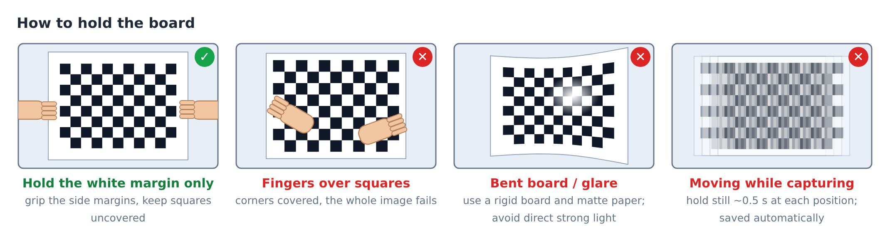
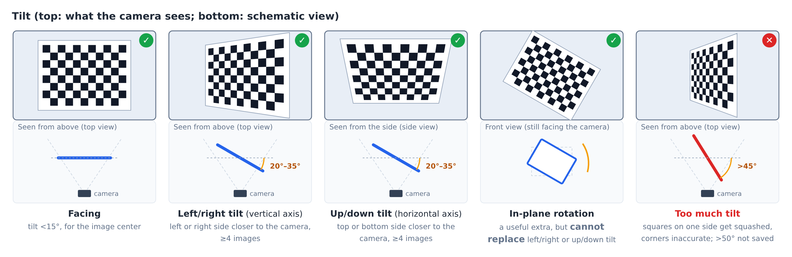
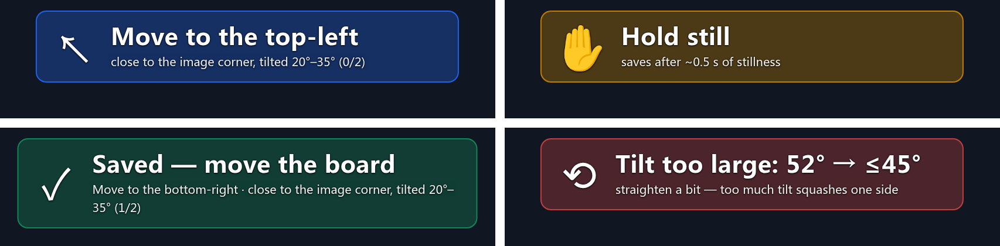
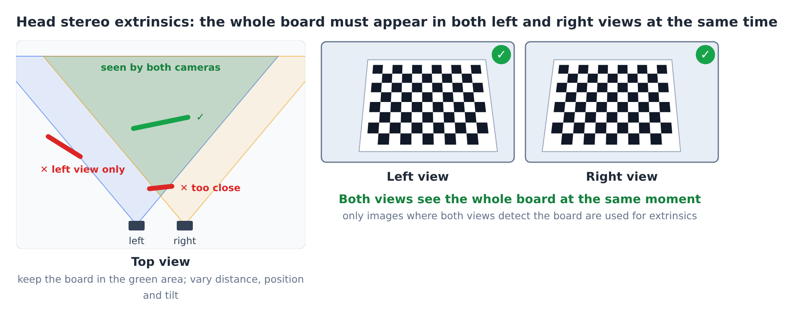
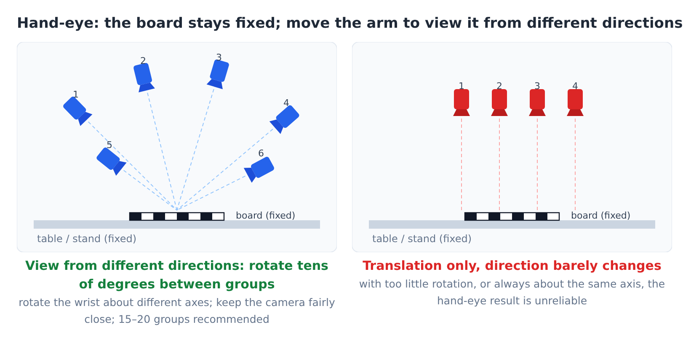
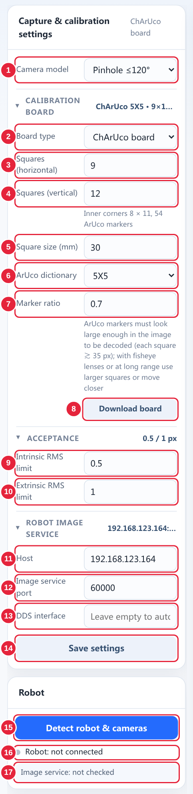
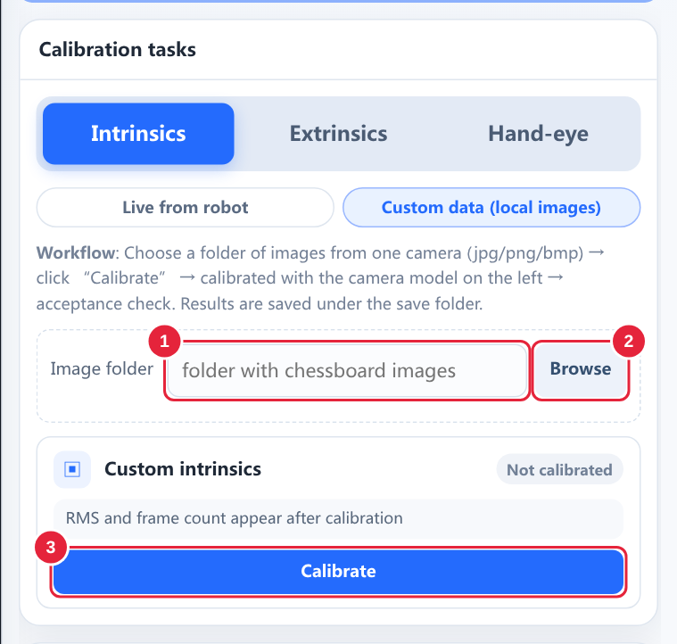
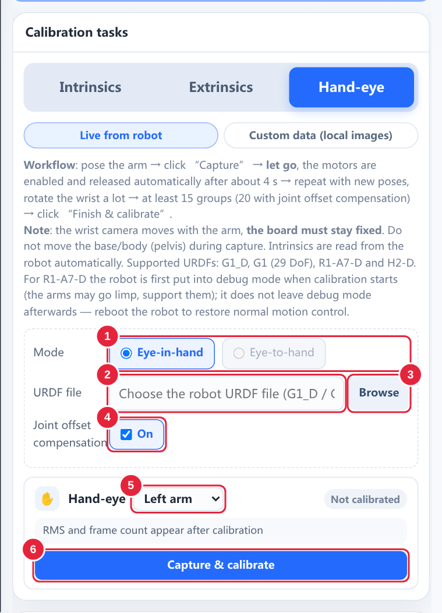
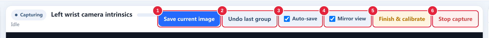

<div align="center">
  <h1 align="center"> UNICALIB </h1>
  <h3 align="center"> Unitree Robotics </h3>
  <p align="center">
    <a> English </a> | <a href="README_zh-CN.md">中文</a>
  </p>
  <p align="center">
    
    
  </p>
</div>

## Important Notes First

- The release is a single AppImage. **No Python or other dependencies need to be installed.** It requires x86_64 Linux with glibc ≥ 2.35 (Ubuntu 22.04 or later).
- Before calibrating with a robot (live capture), the [TeleImager](https://github.com/unitreerobotics/teleimager) image service must be installed and running on the robot (see Section 3). It is not needed when calibrating from existing images ("Custom data").
- **Use TeleImager at commit [`940fd69`](https://github.com/unitreerobotics/teleimager/commit/940fd69616d1a32f2985a4da65d9ae3700780175)** (after v2.0.8, before v2.1.0). **v2.1.0 and later (the latest version) are not supported yet** because the config format changed. Do not install it with `pip install teleimager` from PyPI, which gives the latest version.
- Calibration accuracy **depends mainly on the captured images**. Read Section 4, "Calibration board & capture poses", before you start capturing.
- **R1-A7-D hand-eye calibration switches the robot into debug mode when it starts** (the arms may go limp). It does not switch back automatically; reboot the robot to restore normal motion control (see Section 9).
- During hand-eye capture the arm is actively held in place. **Do not touch the arm while a group is being captured.** A wired (Ethernet) connection to the robot is recommended.
- The URDFs needed for hand-eye calibration are in the [`urdf/`](urdf/) folder of this repository; they are not bundled in the AppImage. Live hand-eye calibration currently supports only G1_D, G1 (29 DoF) and R1-A7-D; for other robots use "Custom data" (Section 9.5).

## 1、 📖 Introduction

UNICALIB is a camera calibration workbench for Unitree robots. Everything runs in the browser: move the board as the on-screen prompts direct, and UNICALIB picks the images, runs the calibration and gives an accept/reject verdict. Results can be copied to the robot with one click.

* **Intrinsic calibration**: left wrist / right wrist / head left / head right camera, or any custom image folder
* **Extrinsic calibration**: head stereo pair, or custom multi-camera data
* **Hand-eye calibration** (eye-in-hand): left / right arm wrist camera, or custom data
* **Camera models**: **Pinhole** (FOV ≤ 120°, OpenCV k1, k2, p1, p2, k3) and **Fisheye KB** (FOV > 120°, Kannala-Brandt KB4, same as OpenCV `cv2.fisheye`)
* **Boards**: Standard checkerboard or ChArUco board, both of which can be generated and downloaded as 1:1 scale PDF files directly from the interface.
* Automatic acceptance checks, a results panel, a hand-eye **3D view**, and one-click **copy to robot**
* **中文 / English** interface

Robots supported for hand-eye calibration (live from robot):

| Robot | URDF (in this repo's `urdf/`) | Kinematic chain (included in forward kinematics) | Notes |
|---|---|---|---|
| G1_D | `g1_d_description/g1_d.urdf` | `AGV_link` → lift → waist pitch → waist yaw → arm | Wheeled base; do not move the base |
| G1 (29 DoF) | `g1_description/g1_29dof_rev_1_0.urdf` | `pelvis` → waist yaw / roll / pitch → arm | Torso must be fixed (hung or propped); waist-locked versions not supported yet |
| R1-A7-D | `r1_d_description/r1_d_with_dex1_1.urdf` | `base_link` → lift → waist yaw → arm | Enter zero-torque mode at startup. |

For robots that do not support “Real-time Robot Data Collection” for hand-eye calibration, use “Custom Data” instead. See Section 9.5 for details.

---

## 2、 ⚙️ Installation & Launch

### 2.1 Package contents

```
uni_clib/
├─ UNICALIB-0.1.7-x86_64.AppImage          the calibration workbench (single file, no install)
├─ UNICALIB-0.1.7-x86_64.AppImage.sha256   checksum
├─ urdf/                                   URDFs + meshes for hand-eye calibration (G1 / G1_D / R1-A7-D), see urdf/README.md
├─ docs/images/                            images used in this document (en/ = English UI versions)
├─ README.md                               English documentation (this file)
└─ README_zh-CN.md                         Chinese documentation
```

### 2.2 Launch

```bash
sha256sum -c UNICALIB-0.1.8-x86_64.AppImage.sha256   # optional: verify the download
chmod +x UNICALIB-0.1.8-x86_64.AppImage
./UNICALIB-0.1.8-x86_64.AppImage
```

### 2.3 Options

| Option | Description |
|---|---|
| `--port 9000` | Preferred port (default 8000). If it is taken, the next free port is used; trust the address printed in the terminal |
| `--no-browser` | Do not open a browser (remote / headless use) |
| `--host 127.0.0.1` | Local access only (default `0.0.0.0`: other machines on the LAN can open `http://<this-PC-IP>:<port>`) |
| `--keep-alive` | Keep running after all pages are closed (resident service) |
| `--appimage-extract-and-run` | Use when the system has no libfuse2 and the AppImage does nothing when started |
| `-h` | Show help |

### 2.4 Requirements

* x86_64 Linux, glibc ≥ 2.35 (Ubuntu 22.04 or later)
* No Python or other dependencies (the `unitree_sdk2py` and cyclonedds needed for hand-eye calibration are bundled)
* For live capture, the TeleImager image service must be running on the robot (Section 3)

### 2.5 Quit

Press `Ctrl+C` in the terminal, or close all pages; the program exits a few seconds later.

---

## 3、 🤖 Robot-side Preparation (required for live capture)

UNICALIB does not run on the robot. It reads the robot's camera images over the network from your PC.
Therefore **the [TeleImager](https://github.com/unitreerobotics/teleimager) image service must be installed and running on the robot.**

This is not needed when calibrating existing images with "Custom data".

### 3.1 TeleImager

UNICALIB works with TeleImager at commit [`940fd69`](https://github.com/unitreerobotics/teleimager/commit/940fd69616d1a32f2985a4da65d9ae3700780175) (after v2.0.8, before v2.1.0):
it requests the camera config from the config port (default 60000), then subscribes to each camera's JPEG stream using the `enable_zmq` / `zmq_port` keys in that config.

> ⚠️ **TeleImager v2.1.0 and later (the latest version) are not supported yet.** v2.1.0 changed the camera config format (`zmq_port` → `color_zmq_port`,
> `enable_zmq` → `enable_color_zmq`, …), so UNICALIB cannot read the camera ports. When it detects this format it reports "The robot runs TeleImager v2.1.0 or later …, which is not supported yet".

On the robot, install from source at that commit (not `pip install teleimager`, which installs the latest version from PyPI):

```bash
git clone https://github.com/unitreerobotics/teleimager.git
cd teleimager
git checkout 940fd69616d1a32f2985a4da65d9ae3700780175
pip install -e ".[server]"        # pick your camera backend, e.g. ".[uvc]", ".[all]"
```

For configuration (camera names, ports, resolution, …), starting and auto-starting, follow the [documentation of that commit](https://github.com/unitreerobotics/teleimager/tree/940fd69616d1a32f2985a4da65d9ae3700780175).
The config file `~/.config/teleimager/teleimager_server.yaml` must use that version's format (each camera has `enable_zmq` and `zmq_port`);
if v2.1.0 or later was installed on the robot before, fill it in again from that version's template `src/teleimager/teleimager_server.yaml`.

Camera names: head stereo `head_camera` (or `head_stereo_camera`, side-by-side, `binocular: true`);
wrists `left_wrist_camera` / `right_wrist_camera` (or `wrist_left_camera` / `wrist_right_camera`). Both naming schemes are recognized.

### 3.2 Network and login

* Your PC and the robot are on the same network and the robot IP is reachable (default `192.168.123.164`)
* SSH is enabled on the robot: UNICALIB uses it to read the robot ID and other information, and to write calibration results to `/home/unitree/calib/` on the robot
* For hand-eye calibration, joint states are read and the arm is held **via DDS directly from your PC**; nothing extra has to be installed or run on the robot.
  Your PC must therefore be on the robot's DDS network (e.g. the `192.168.123.x` subnet). **A wired connection is recommended** (hold commands are sent at 250 Hz and Wi-Fi packet loss degrades the hold)

### 3.3 Check the connection

1. Make sure the TeleImager service is running on the robot (see the [TeleImager](https://github.com/unitreerobotics/teleimager) documentation)
2. In UNICALIB, fill in the robot IP and config port under "Robot image service" on the left (default `192.168.123.164` / `60000`)
3. Click **Detect robot & cameras**. The first time you will be asked for the robot's SSH username and password (kept only in program memory and cleared on exit). On success the robot ID, each camera, and its actual resolution and frame rate are shown

---

## 4、 🎯 Calibration Board & Capture Poses (important)

Calibration accuracy **depends mainly on the captured images**. A small reprojection error means little if the poses are monotonous or the image corners and edges are never covered.
The requirements below combine UNICALIB's capture rules with published calibration practice. During live capture the program checks every item and prompts you;
with custom data, please capture according to this section yourself.

### 4.1 Why capture this way

| Requirement | Reason |
|---|---|
| The board must **cover all four corners and four edges of the image** | Lens distortion grows from the center outward; only corners near the edges constrain the distortion parameters. In regions never covered, the result is a guess |
| The board must be **tilted both left/right and up/down** | Focal length and principal point come only from foreshortening; with all images facing the camera squarely, focal length is poorly determined |
| Tilt **no more than 45°** | With too much tilt, squares on one side are squashed, corner localization degrades and can even become biased |
| **Every pose different** | Parallel board planes or pure translations add no information (degenerate cases of Zhang's method); 20 distinct images beat 100 similar ones |
| Board **as large as possible, over 50% of the image** | More, wider-spread corners give stronger constraints; a small board gives few, crowded corners |
| Board **pushed to the image edges** | The closer to the edge, the more edge corners and the better the distortion constraint; stopping just short of the edge loses a whole ring of corners |
| Board **flat, matte, and still** when captured | Bending, glare and motion blur all shift corner positions, and those errors go straight into the result |

### 4.2 Prepare the board

* In the settings on the left (Section 6), choose the board type and fill in the number of squares and square size, then click **Download board** to get a 1:1 PDF. Print at "Actual size / 100%", no scaling
* After printing, **measure the square size with a ruler** and enter the measured value in "Square size (mm)"
* Mount it on something **rigid and flat** (acrylic, aluminium, foam board, …) using **matte** paper; avoid curled edges and bulges
* Leave a **white margin (at least one square wide)** around the pattern; hold it by the margin and do not cover any squares
* For extrinsic calibration with a plain chessboard, the numbers of horizontal and vertical squares must differ (e.g. 9×12); a ChArUco board has no such requirement
* Use even, soft lighting; avoid direct strong light and shadows. Do not change camera focus or resolution during calibration

#### Plain chessboard or ChArUco board?

| | Plain chessboard (default) | ChArUco board |
|---|---|---|
| Appearance | Black and white squares | ArUco markers in the white squares; every corner has a unique ID |
| Partial occlusion / partly out of frame | Not allowed; the whole board must be visible | Allowed for intrinsic / extrinsic capture: ≥ 30% and ≥ 8 corners per view is enough |
| Square-count requirement for extrinsics | Horizontal and vertical counts must differ (avoids 180° ID ambiguity) | None |
| Detection distance | Detected even when fairly far | Markers are smaller than squares; each square needs about **35 px or more** in the image |
| Best for | General use | Fisheye image edges, small stereo overlap, boards hard to fit fully in frame |

* With a ChArUco board, **ArUco dictionary** (4X4 / 5X5 / 6X6 / 7X7; dictionary size is chosen automatically from the marker count, e.g. 9×12 squares + 5X5 → `DICT_5X5_100`)
  and **Marker ratio** (marker side / square side, default 0.7) must match the printed board. **Printing the PDF from "Download board" is recommended**
* With fisheye lenses or at long range the markers may not be detected; use larger squares or bring the board closer

### 4.3 How to hold the board



* **Hold only the white margins on both sides**; keep fingers off the squares. With a plain chessboard, if any corner is covered the whole image is rejected
* Keep the board flat, not bent; if there is glare, turn it slightly or change the lighting
* **Hold still for about 0.5 s at each position**. The program saves automatically once the board is still (the prompt turns green), then move on. Do not keep waving it around
* For both wrist and head cameras the camera is fixed and you move the board. When facing the camera, tick **Mirror view** so left and right in the image match your own
* Keep the distance close to the real working distance, with some near/far variation. Too far gives tiny corners; too close tends to blur or leave the frame

### 4.4 Intrinsics: which poses to capture

**① Nine positions in the image**: center, facing the camera; for the four corners and four edges, **push the board right up to the image border** (still fully visible; the white margin may touch the border), while the board fills **more than 50%** of the image. At least 2 images per position (the second one with a different tilt).

**In a corner, tilt the side nearest the image corner towards the camera**: that side then appears wider, so the board's outer corner reaches the image corner and the corner points there, where distortion is largest, get captured.
Tilt directions for the four corners are shown below: top-left and top-right — top edge closer to the camera; bottom-left and bottom-right — bottom edge closer. On the left and right edges, the side nearest the image border is closer to the camera.
If you tilt the other way (the side nearest the corner farther away), that corner is left partly empty and some corner points are lost.

> With the board over 50% of the image, it covers several cells of the grid when in a corner — that is normal. What matters is that **two of its edges touch the image border**.


**② Tilt**: you need **both** left/right tilt (left or right side closer to the camera) and up/down tilt (top or bottom closer), mostly 20°–35°, never more than 45°.
In-plane rotation (turning the board within its own plane) is a useful extra but **cannot replace** tilt.



**③ Size**: in every image the board should fill **more than 50%** of the frame; at least 2 images should nearly fill it (≥ 65%) with a slight tilt; a plain chessboard must be **fully** inside the image.
The page's "current: xx% of image (suggested 30%–60%)" is only the program's minimum hint; aim for over 50% in practice.


#### When the program considers capture complete (live capture)

Capture ends and calibration starts automatically once every row below is satisfied and the total count is reached:

| Item | Requirement | Count |
|---|---|---|
| Center, facing | Board in the image center, tilt < 15° | 2 |
| Corners, tilted | Board at an image corner (outline < 12% from both borders, **not touching the opposite borders**), tilt ≥ 20°, side nearest the corner closer to the camera | 2 per corner, 8 total |
| Edges | Board at the middle of each edge (outline < 12% from that border), facing or tilted | 2 per edge, 8 total |
| Fill the frame | Board ≥ 65% of the image, slightly tilted | 2 |
| Left/right tilt | Tilt about the vertical axis ≥ 20° | ≥ 4 |
| Up/down tilt | Tilt about the horizontal axis ≥ 20° | ≥ 4 |
| Total | | ≥ 20 (max 40) |

Images are **not saved** in these cases, and the prompt shows why: board incomplete (for ChArUco: too few corners detected), < 12% of the image, tilt > 50°, still moving, glare, blur, or nearly identical to a saved image.

#### Recommended order

The order is not enforced; the prompt always points to the nearest item still missing. First bring the board to a distance where it fills over 50% of the image, keep roughly that distance throughout, and work mainly with translation and tilt:

1. **Center**: board facing the camera in the middle of the image; hold still, 2 images (change the distance slightly for the second)
2. **Four corners**: top-left → top-right → bottom-right → bottom-left. Push the board so two of its edges touch the image border, and **tilt the side nearest the image corner towards the camera** by 20°–35°:
   top edge closer for the top corners, bottom edge closer for the bottom corners. The board's outer corner should reach the image corner. 2 images per corner.
   Once the four corners are done, up/down tilt is covered as well
3. **Left and right edges**: board at the middle of the left / right edge, with **the side nearest that edge** tilted towards the camera by 20°–35°, 2 images each. This also covers left/right tilt
4. **Top and bottom edges**: board at the middle of the top / bottom edge, 2 images each
5. **Fill the frame**: bring the board closer until it almost fills the image, with a slight tilt, 2 images
6. **Fill the gaps**: check which items under "Poses" on the left still show ○ and follow the prompts

> **Why up/down tilt in the corners and left/right tilt on the side edges**: the board is "squarer" than the image. When a large board is tilted left/right in a corner, the edge closer to the camera grows taller
> and easily touches the opposite border, so it no longer counts as a "corner". With up/down tilt the board gets shorter vertically, making it easier to be both large and against the border in a corner.
> The tilt direction is as described above: the side towards the image corner is closer to the camera, so the board's corner reaches the image corner.

> **Fisheye cameras**: distortion is largest at the edges and corners, so push the board all the way to the image border (a plain chessboard must still be fully visible). A board near the edge looking small and curved is normal; as long as it is detected, it counts.
> If it is hard to get the whole board to the edge, switch to a ChArUco board.

#### What to watch during capture

**Corner & pose coverage** on the left shows progress live: the 3×3 grid is the number of saved images at the nine image positions (red = 0, yellow = not enough, green = done, blue frame = where the board is now);
"Poses" below shows completion of each row of the table above; the top shows the board's current share of the image and its tilt.


The large prompt on the preview tells you what to do next. Colors: **blue = move somewhere / adjust tilt, yellow = hold still, green = saved, red = problem** (board not fully visible, too small, too tilted, glare).



### 4.5 Head stereo extrinsics



* Every image must show **the whole board in both the left and right views at the same time**; images where it is in only one view are not used for extrinsics
  (a ChArUco board may be partly out of frame: ≥ 30% and ≥ 8 corners detected in each view is enough)
* Keep the board in the area both cameras can see; too close to the cameras and it leaves one of the views
* Position, tilt and size requirements are the same as for intrinsics (progress is counted on the left view; the left panel shows corner grids for both views)
* Extrinsics use the existing left and right intrinsics, so calibrate the left and right intrinsics first

### 4.6 Hand-eye (eye-in-hand)



In hand-eye calibration the camera moves with the arm and the board stays fixed, so **the capture strategy is completely different from intrinsics**:

* **The board is fixed** on a table or stand and must not move at all; the robot base and torso must not move either
* **Rotate a lot between groups**: consecutive wrist poses should differ by tens of degrees, not small wiggles; the total rotation span over all groups must be at least 30°, the more the better
* **Rotate about different axes**: turn the wrist in different directions (pitch up/down, yaw left/right, roll about the camera's line of sight) and combine them; always rotating about the same axis gives an unreliable result
* **Groups that only translate without rotating are almost useless** (right side of the figure above)
* Keep the camera **fairly close to the board** while the whole board is visible and fills over 50% of the image; vary the board's position in the image too, reaching towards the edges
* With "Joint offset compensation" on, make every joint of the arm move noticeably; the left panel shows which joints need "more rotation"
* After clicking **Capture** for each group, let go and do not touch the arm; the program holds the arm and captures automatically. At least 15 groups are required to finish (20 with joint offset compensation); 15–20 is recommended

Suggested order: camera looking straight down at the board → tilt the wrist forward / back / left / right by 20°–35°, one group each → from these poses, roll about the line of sight by ±30°–45° → change height and position and repeat, combining rotations in different directions.

---

## 5、 🖥️ Interface Overview


| No. | Area / button | Purpose |
|---|---|---|
| 1 | 中文 / EN | Switch interface language |
| 2 | ⓘ Board handling tips | Hover to see how to move, tilt and distance the board during live capture |
| 3 | ⓘ Folder layout | Hover to see the result folder layout and how to prepare custom data (intrinsics / extrinsics / hand-eye) |
| 4 | Service status | "Service connected" (green dot) means the page is connected to the local UNICALIB program; "Service disconnected" means the program has exited — restart the AppImage |
| 5 | Capture & calibration settings | Camera model, board, acceptance, robot image service — see Section 6 |
| 6 | Robot | **Detect robot & cameras**; shows robot ID and camera status — see Section 6 |
| 7 | Corner & pose coverage | During live capture: corner coverage of the 3×3 image regions, and whether enough board poses (left/right, up/down tilt, near/far) have been captured |
| 8 | Task status bar | Current stage (waiting / capturing / calibrating / done), task name, progress bar and messages |
| 9 | Mirror view | Tick when facing the camera so left/right in the image and prompts match the operator; during capture more buttons appear here — see Section 10 |
| 10 | Live preview | Camera image, detected corners and large movement prompts; instructions below |
| 11 | Save folder | Where all calibration results are saved. Type a path or click **Browse** to open the folder picker (below) |
| 12 | Copy calibration to robot | Write local results to the robot — see Section 12. Greyed out until the robot ID has been read |
| 13 | Calibration type | Intrinsics / Extrinsics / Hand-eye |
| 14 | Data source | **Live from robot** (capture on site) / **Custom data (local images)** (use existing images) |
| 15 | Task card | Choose the camera or arm, see status (Not calibrated / Usable / Not usable), and start. Card content depends on 13 and 14 — see Sections 7–9 |
| 16 | Result | After a task: reprojection error (RMS / P95), valid frame count and usable or not; for hand-eye, the **3D view** is here |
| 17 | Log | Actions and messages of this session (last 300 entries) |

### Folder / file picker

Any **Browse** button opens this window (it browses files on the PC running UNICALIB):


| No. | Purpose |
|---|---|
| 1 | Up one level |
| 2 | Current path; click any segment to jump there |
| 3 | Shortcuts: last selected folder, home, mounted disks, root |
| 4 | Folders in the current directory (when picking a file, selectable files are listed too). Folders with images show the image count; folders matching the extrinsic data layout are marked "extrinsic data root". Click a folder to enter it; when picking a file, click the file to select it |
| 5 | Type a path and press Enter to jump |
| 6 | Select the current folder |

---

## 6、 🛠️ Settings Before You Start (left panel)



Click the "Calibration board", "Acceptance" or "Robot image service" headings to expand / collapse them. The screenshot shows the panel with "ChArUco board" selected; with a plain chessboard, items 6 and 7 are hidden.

| No. | Setting / button | Description |
|---|---|---|
| 1 | Camera model | Pinhole ≤ 120° / Fisheye KB > 120°, chosen by the lens field of view. Used for both intrinsics and extrinsics |
| 2 | Board type | **Plain chessboard** (default) or **ChArUco board**, see 4.2 |
| 3 | Squares (horizontal) | Number of **squares**, not corners. The inner-corner count (squares − 1) is shown below, plus the marker count for a ChArUco board |
| 4 | Squares (vertical) | Same as above. For extrinsics with a plain chessboard the two counts must differ (e.g. 9×12) |
| 5 | Square size (mm) | The measured size of the printed squares. Sets the scale of extrinsic / hand-eye translations, so **enter it accurately** |
| 6 | ArUco dictionary | ChArUco only: 4X4 / 5X5 / 6X6 / 7X7; must match the printed board |
| 7 | Marker ratio | ChArUco only: ArUco marker side / square side (default 0.7); must match the printed board |
| 8 | Download board | Generates a true-scale (1:1) PDF of the board (plain chessboard or ChArUco) from the settings above; print at "Actual size / 100%", no scaling |
| 9 | Intrinsic RMS limit | Intrinsic reprojection error above this (px) is rejected |
| 10 | Extrinsic RMS limit | Extrinsic reprojection error above this (px) is rejected |
| 11 | Host | Robot IP, i.e. where the TeleImager image service runs (default `192.168.123.164`) |
| 12 | Image service port | TeleImager config port (default `60000`) |
| 13 | DDS interface | Network interface **on this PC** for DDS joint data during hand-eye calibration (e.g. `eth0`, `enp3s0`). Usually leave empty: the interface connected to the robot is chosen automatically |
| 14 | Save settings | Saves all settings on the left; they are reused on the next start |
| 15 | Detect robot & cameras | Connects to the robot: asks for SSH username/password the first time, then reads the robot ID and detects the image service's cameras with their actual resolution / frame rate |
| 16 | Robot status | Connected or not, and the robot ID |
| 17 | Image service status | Whether the image service is available; after a successful check, expand "Details" to see each camera |

---

## 7、 📷 Intrinsic Calibration

### 7.1 Live from robot

Calibration type **Intrinsics**, data source **Live from robot**:


| No. | Purpose |
|---|---|
| 1 | Camera to calibrate: Left wrist camera / Right wrist camera / Head left camera / Head right camera |
| 2 | Its status: Not calibrated / Capturing / Usable / Not usable |
| 3 | Last result (RMS, P95, frames); during capture, the number of frames captured |
| 4 | **Capture & calibrate**: connects to the image service and starts capturing. Move the board as prompted (see Section 4); once enough is captured it calibrates and checks the result automatically |

### 7.2 Custom data

Calibration type **Intrinsics**, data source **Custom data (local images)**:



| No. | Purpose |
|---|---|
| 1 | Image folder: board images taken by one camera (20–40 recommended, captured as in Section 4) |
| 2 | Browse: opens the folder picker |
| 3 | **Calibrate**: uses the camera model and board settings on the left; the verdict appears under "Result" |

> Supported image formats for custom data (intrinsics / extrinsics / hand-eye): `.jpg`, `.jpeg`, `.png`, `.bmp` (extension case-insensitive).
> Only images directly in the selected folder are read, not subfolders.

---

## 8、 🔭 Extrinsic Calibration

### 8.1 Head stereo (live from robot)

Calibration type **Extrinsics**, data source **Live from robot**:


| No. | Purpose |
|---|---|
| 1 | Last result, and the status of local left / right intrinsics |
| 2 | **Capture & calibrate** |

* The **left camera is the reference**; usable left and right intrinsics are required first
* The program looks for intrinsics both on the robot and locally (latest):
  if only one is usable it is used; if both are, a dialog lets you choose; if neither, you are asked to calibrate the left and right intrinsics first
* After starting, move the board as prompted so it appears in both views; only images where both views detect the board (complete for a plain chessboard, enough corners for ChArUco) are used

### 8.2 Custom data

Calibration type **Extrinsics**, data source **Custom data (local images)**:


| No. | Purpose |
|---|---|
| 1 | Data root (layout below) |
| 2 | Browse: opens the folder picker; cameras are detected automatically after selection |
| 3 | Reference camera: extrinsics are given as other camera → reference camera transforms |
| 4 | **Calibrate** |

Data root layout (images taken at the same moment share the same file name):

```
data_root/
├─ images/cam0/00001.png, images/cam1/00001.png, …
└─ intrinsic/cam0/calib.json, intrinsic/cam1/calib.json, …   (optional)
```

* `cam*` subfolders under `images/` are detected automatically (at least 2); the reference camera is selectable (default: lowest number)
* Intrinsics: each camera reads `intrinsic/cam*/calib.json` (if there is no `calib.json`, a single `.json` in the folder also works)
* **Cameras without intrinsics are first calibrated from their own images** (using the camera model currently selected on the page), then extrinsics are calibrated;
  the whole `intrinsic/` folder may be omitted, in which case all cameras are calibrated automatically

> The board does **not** need a red marker.

---

## 9、 🦾 Hand-eye Calibration (eye-in-hand)

Only **eye-in-hand** is supported (camera on the wrist, board fixed).

### 9.1 Preparation

* **The board is fixed**; do not move the base
* Have the robot's URDF ready: this repo's [`urdf/`](urdf/) folder provides G1 (29 DoF), G1_D and R1-A7-D; see the table in Section 1. Waist-locked G1 versions are not supported yet
* First **calibrate the wrist camera's intrinsics and copy them to the robot** (hand-eye calibration reads the wrist intrinsics from `/home/unitree/calib/uniclib_calibration.json` on the robot)
* **Use a wired connection to the robot**: joint data and hold commands go over DDS from this PC; if no joint data arrives for 0.3 s the hold is released automatically
* **G1**: the torso must be fixed (hung or propped) during calibration; the legs are not controlled while the arm is held
* **R1-A7-D**:
  * At the start the program **switches the robot into debug mode** (the arms may go limp — support them or put them in a safe position first). It does **not switch back automatically**; reboot the robot to restore normal motion control
  * The lift must be homed, otherwise calibration is refused

### 9.2 Live from robot

Calibration type **Hand-eye**, data source **Live from robot**:



| No. | Purpose |
|---|---|
| 1 | Mode: Eye-in-hand (camera on the wrist, board fixed); "Eye-to-hand" is not supported yet |
| 2 | URDF file: path to the robot's URDF (G1_D / G1 29 DoF / R1-A7-D) |
| 3 | Browse: opens the file picker to choose a `.urdf` file |
| 4 | Joint offset compensation: also estimates joint zero offsets (on by default, needs at least 20 groups) |
| 5 | Arm: left / right |
| 6 | **Capture & calibrate**: starts group-by-group capture; use the **Capture** button above the preview for each group (Section 10) |

Steps:

1. Choose the URDF and arm, click **Capture & calibrate**. The page first shows the robot model and kinematic chain recognized from the URDF; capture starts after you confirm
2. Move the arm by hand to a pose where the whole board is visible in the wrist camera
3. Click **Capture** above the preview, then **let go**: the program holds this arm in place, waits for it to settle, captures for about 1 s, then releases it (about 4 s in total).
   **Do not touch the arm during capture.**
4. Repeat steps 2–3, rotating tens of degrees between groups about different axes (total rotation span ≥ 30°)
5. At least 15 groups are needed to finish (20 with joint offset compensation); 15–20 recommended. See 4.6 for how to choose poses
6. Groups that fail (too much jitter / drift, board not detected) are not saved and the reason is shown; **Undo last group** removes the latest group

> Hold safety: before enabling, the program checks that nothing else is controlling the arm; gains ramp up gradually; the hold is released immediately on large joint deviation or speed, interrupted joint data, program exit, or when you click Stop.

### 9.3 Custom data

Calibration type **Hand-eye**, data source **Custom data (local images)**:


| No. | Purpose |
|---|---|
| 1 | Mode: Eye-in-hand |
| 2 | Image folder: board images from the wrist camera (board fixed) |
| 3 | End-effector pose file: wrist pose for each image (format below) |
| 4 | Pose translation unit: metres (m) / millimetres (mm) |
| 5 | Camera intrinsics file: `calib.json`, must contain `camera_model` |
| 6 | **Calibrate**; results are saved locally only |

The **Browse** buttons next to 2, 3 and 5 open the picker.

Poses are matched to images by file name, in either format:
* Text: one line per image, `filename x y z qx qy qz qw` (comma or space separated, `#` for comments, translation in m or mm)
* JSON: `{"000001": 4×4 matrix | [x,y,z,qx,qy,qz,qw] | {"position", "quaternion"}}`

### 9.4 Viewing the result

**3D view** in the result panel shows the robot, the calibrated camera position and field of view, and the board; you can step through the captured poses group by group and compare with the real robot.

> If joint offset estimation is on and you use the compensated result, forward kinematics must use **actual joint angle = reading + offset**.


### 9.5 Other robots

Live capture needs to know where each joint is read from (lowstate motor index, lift / waist topics) and how to hold the arm.
This is built into the program per robot model; currently only **G1_D, G1 (29 DoF) and R1-A7-D** are supported.

* **How the model is recognized**: first by the URDF's `<robot name>`, then by checking the number, type and axis of the movable joints on `<base_link> → <left/right>_wrist_yaw_link`;
  if the name is not recognized, the joints are matched against each model
* **Other robots** (including waist-locked G1, the 23-DoF G1 and other models): before capture starts you get "The selected URDF … matches no supported robot model"
  or "… but the joint check failed". **Capture cannot start**, and the robot is never connected to or driven
* **Use "Custom data" instead** (9.3), which works with any robot:
  1. Fix the board and move the arm through different poses (as in 4.6). For each pose take one image with the wrist camera and record the wrist (end-effector) pose in the robot base frame
     (computed with that robot's own SDK / forward kinematics); write the poses in the format of 9.3
  2. Prepare the wrist camera's intrinsics file `calib.json` (e.g. from "Intrinsics" calibration first)
  3. Choose the image folder, pose file, translation unit and intrinsics file, then click **Calibrate**. The result is saved locally in `handeye/custom/<time>/handeye.json`
     and is not copied to the robot automatically
* Live support for a new robot model requires adding that model's configuration to the program (joint ↔ lowstate index mapping, lift / waist topics, hold gains, …)
  and releasing a new AppImage; please contact the developers

---

## 10、 ⏺️ Buttons During Live Capture

Once live capture starts, these buttons appear above the preview (each task shows only some of them):



| No. | Button | Purpose |
|---|---|---|
| 1 | Save current image | Intrinsics / extrinsics: save the current frame manually (the only way when auto-save is off). For hand-eye it becomes **Capture (~1 s)**: one group per click |
| 2 | Undo last group | Hand-eye only: delete the most recently saved group |
| 3 | Auto-save | On: saves when the board has been still for about 0.5 s; off: save only with button 1 |
| 4 | Mirror view | Tick when facing the camera so left/right match the operator |
| 5 | Finish & calibrate | Do not wait for auto-finish; calibrate now with the images captured so far |
| 6 | Stop capture | Abandon this capture **without calibrating** (cannot stop once calibration has started) |

### Prompts during capture

* The large prompt shows the next step: blue = move somewhere / adjust tilt, yellow = hold still, green = saved, red = problem (board not fully visible, too small, too tilted, glare)
* Each position is saved automatically after **holding still for about 0.5 s**; images too similar to saved ones are skipped
* When everything under **Corner & pose coverage** is satisfied, capture ends and calibration starts automatically; you can also click **Finish & calibrate** at any time
* For how to hold the board and which positions and angles to capture, see **Section 4**

---

## 11、 ✅ Acceptance

Each task shows **RMS** and **P95** (95th percentile of reprojection error) and the number of frames used; it is marked **Usable** only if all checks pass.

Default hand-eye acceptance: reprojection ≤ 5 px, board position consistency ≤ 10 mm, rotation consistency ≤ 1°, ≥ 15 groups, rotation span ≥ 30°.

---

## 12、 📤 Copy Results to the Robot

First click "Detect robot & cameras" on the left to read the robot ID, then click **Copy calibration to robot** above the task list on the right:

1. The program reads the existing `/home/unitree/calib/uniclib_calibration.json` on the robot
2. It compares RMS and P95 item by item with the latest local results; if the robot's result is clearly better it is highlighted in red and kept by default
3. For each item choose "Use new local" or "Keep robot's"
4. Click **Merge & copy selection**: everything is merged into one file and written to the robot; the old file is backed up as `uniclib_calibration.<time>.json`

* The robot ID is checked again before writing; on mismatch the copy is cancelled
* If the intrinsics used by the head stereo extrinsics differ from the left/right intrinsics about to be written (e.g. extrinsics used local intrinsics but you chose to keep the robot's old intrinsics), the dialog warns you and asks again before copying

---

## 13、 📁 Where Results Are Saved

```
<save folder>/
├─ <robot ID>/                         one folder per robot (live capture)
│  ├─ device.json                      robot information
│  ├─ images/<camera>/<time>/          captured images
│  ├─ intrinsic/<camera>/<time>/calib.json, quality.json
│  ├─ extrinsic/head_stereo/…
│  ├─ handeye/<left_arm|right_arm>/…
│  └─ uniclib_calibration.json         merged file last copied to the robot
├─ intrinsic/custom/                   custom-data intrinsics
├─ extrinsic/custom/                   custom-data extrinsics
└─ handeye/custom/<time>/handeye.json  custom-data hand-eye
```

The robot ID has the form `<Jetson module serial>_<eth0 MAC>` and is read automatically when connecting.

Main fields of `calib.json`: `camera_model` (`Pinhole` / `Fisheye`, where Fisheye is Kannala-Brandt KB4), `image_size` ([height, width]), `intrinsic` (fx, fy, cx, cy + distortion coefficients), `rms_reproj_err_px`.

The `handeye` section of the merged `uniclib_calibration.json` holds `T_wrist_cam` (reference link `<left|right>_wrist_yaw_link`) and the joint offsets.

### Settings and logs

| Item | Location |
|---|---|
| Page settings | `~/.config/uniclib/` (override with the `UNICLIB_CONFIG_DIR` environment variable) |
| Log | `~/.config/uniclib/logs/uniclib.log` |

Error messages on the page carry an error code; please include the code and the log file when reporting a problem.

---

## 14、 ❓ FAQ

| Symptom | What to do |
|---|---|
| The AppImage does nothing | Run it from a terminal to see the output; if FUSE is missing, add `--appimage-extract-and-run` |
| Port already in use | The next free port is used automatically; trust the address printed in the terminal |
| Cannot connect to the image service | Make sure TeleImager is running on the robot; check host / port on the left, or click "Detect robot & cameras" |
| A camera is not detected | Check the camera configuration of TeleImager on the robot (see the TeleImager documentation) |
| "The robot runs TeleImager v2.1.0 or later … not supported yet", or no cameras detected at all | The robot is running TeleImager v2.1.0 or later (not supported yet). Switch to commit `940fd69` as described in 3.1 and use a config file in that version's format |
| Hand-eye says the URDF "matches no supported robot model" or "the joint check failed" | The robot model is not supported (or the wrong URDF was chosen), see 9.5 |
| "Robot ID not read yet" | Check that you can SSH into the robot, or click "Detect robot & cameras" |
| Extrinsics say inner corners must be non-square | Use a board with different horizontal / vertical square counts (e.g. 9×12), or switch to a ChArUco board |
| ChArUco board not detected / too few corners | Check that ArUco dictionary, marker ratio and square counts match the printed board (print the PDF from "Download board"); bring the board closer or use larger squares (about 35 px per square or more) |
| Head stereo says no usable intrinsics | Calibrate the head left and right intrinsics first (error passed, camera model matching the current setting) |
| Hand-eye says no wrist intrinsics | Calibrate the wrist intrinsics and copy them to the robot first |
| Hand-eye gets no joint data / hold keeps releasing | Make sure the PC is on the robot's subnet over a wired connection; if needed, enter the PC's interface towards the robot in "DDS interface" |
| R1-A7-D does not resume normal motion after calibration | Calibration switched it into debug mode, which is not undone automatically; reboot the robot |
| R1-A7-D says the lift is not homed | Home the lift first, then start hand-eye calibration |
| Capture never finishes by itself | Fill in the missing regions or poses as prompted, or click "Finish & calibrate" |
| Robot ID mismatch when copying | You are connected to a different robot than the results belong to; check the address and read the ID again |
| Result "Not usable" or large error | Check against Section 4: corners / edges covered, both left/right and up/down tilt present, board flat without glare, square size accurate; capture more and recalibrate |
| Calibration fails with an error code | Check the board settings and camera model, add images at more positions / angles / distances and retry |

---

## 📋 TODO List

- ⬜ Eye-to-hand calibration
- ⬜ Support for more systems (e.g. Ubuntu 20.04 and other older glibc versions)

## 🙏 Acknowledgement

This tool uses or builds on the following open-source projects. Please refer to each project for its license:

1. three.js: https://github.com/mrdoob/three.js
2. FastAPI: https://github.com/fastapi/fastapi
3. unitree_sdk2_python: https://github.com/unitreerobotics/unitree_sdk2_python
4. Eclipse Cyclone DDS: https://github.com/eclipse-cyclonedds/cyclonedds-python
5. TeleImager: https://github.com/unitreerobotics/teleimager
6. unitree_ros (G1 URDF): https://github.com/unitreerobotics/unitree_ros
