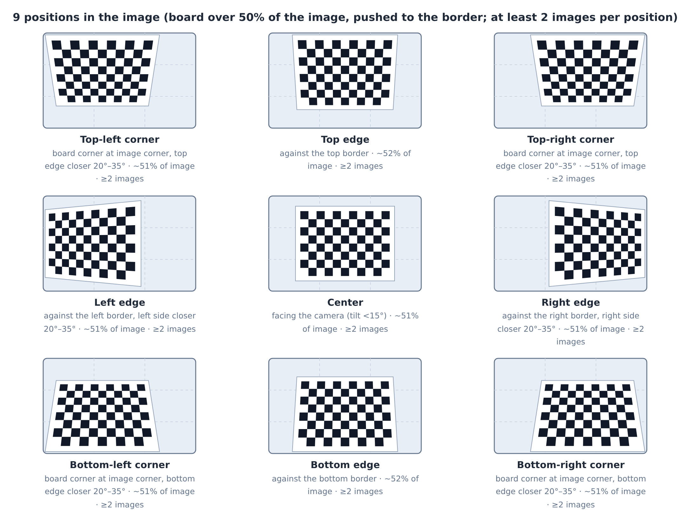
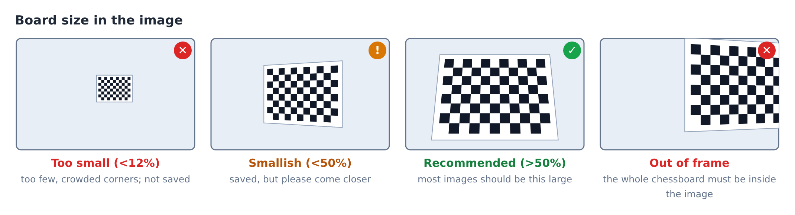
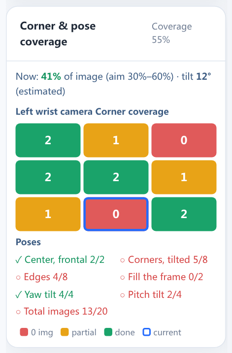

<div align="center">
  <h1 align="center"> UNICALIB </h1>
  <h3 align="center"> Unitree Robotics </h3>
  <p align="center">
    <a> English </a> | <a href="README_zh-CN.md">中文</a>
  </p>
  <p align="center">
    
    
  </p>
</div>

## 1、 📖 Introduction

UNICALIB is a camera calibration workbench for Unitree robots. Everything runs in the browser: move the board as the on-screen prompts direct, and UNICALIB picks the images, runs the calibration and gives an accept/reject verdict. Results can be copied to the robot with one click.

* **Intrinsic calibration**: left wrist / right wrist / head left / head right camera, or any custom image folder
* **Extrinsic calibration**: head stereo pair, or custom multi-camera data
* **Hand-eye calibration** (eye-in-hand): left / right arm wrist camera, or custom data
* **Camera models**: **Pinhole** (FOV ≤ 120°, OpenCV k1, k2, p1, p2, k3) and **Fisheye KB** (FOV > 120°, Kannala-Brandt KB4, same as OpenCV `cv2.fisheye`)
* **Boards**: Standard checkerboard or ChArUco board, both of which can be generated and downloaded as 1:1 scale PDF files directly from the interface.
* Automatic acceptance checks, a results panel, a hand-eye **3D view**, and one-click **copy to robot**
* **中文 / English** interface

Robots supported for hand-eye calibration (live from robot):

| Robot | URDF (in this repo's `urdf/`) | Kinematic chain (included in forward kinematics) | Notes |
|---|---|---|---|
| G1_D | `g1_d_description/g1_d.urdf` | `AGV_link` → lift → waist pitch → waist yaw → arm | Wheeled base; do not move the base |
| G1 (29 DoF) | `g1_description/g1_29dof_rev_1_0.urdf` | `pelvis` → waist yaw / roll / pitch → arm | Torso must be fixed (hung or propped); waist-locked versions not supported yet |
| R1-A7-D | `r1_d_description/r1_d_with_dex1_1.urdf` | `base_link` → lift → waist yaw → arm | Enter zero-torque mode at startup. |

For robots that do not support “Real-time Robot Data Collection” for hand-eye calibration, use “Custom Data” instead. See Section 9.5 for details.

---

## 2、 ⚙️ Installation & Launch

### 2.1 Package contents

```
uni_clib/
├─ UNICALIB-0.1.7-x86_64.AppImage          the calibration workbench (single file, no install)
├─ UNICALIB-0.1.7-x86_64.AppImage.sha256   checksum
├─ urdf/                                   URDFs + meshes for hand-eye calibration (G1 / G1_D / R1-A7-D), see urdf/README.md
├─ docs/images/                            images used in this document (en/ = English UI versions)
├─ README.md                               English documentation (this file)
└─ README_zh-CN.md                         Chinese documentation
```

### 2.2 Launch

```bash
sudo apt install git-lfs
git lfs install
git clone https://github.com/unitreerobotics/uni_calib.git
cd uni_calib
git lfs pull
sha256sum -c UNICALIB-0.1.7-x86_64.AppImage.sha256   # optional: verify the download
chmod +x UNICALIB-0.1.7-x86_64.AppImage
./UNICALIB-0.1.7-x86_64.AppImage    ## Or double-click the AppImage to launch it.
```

To obtain a specific version:

```bash
sudo apt install git-lfs
git lfs install
git clone https://github.com/unitreerobotics/uni_calib.git
cd uni_calib
git fetch --tags
git checkout v0.1.7
git lfs pull

sha256sum -c UNICALIB-0.1.7-x86_64.AppImage.sha256   # optional: verify the download
chmod +x UNICALIB-0.1.7-x86_64.AppImage
./UNICALIB-0.1.7-x86_64.AppImage    ## Or double-click the AppImage to launch it.
```

### 2.3 Requirements

* x86_64 Linux, glibc ≥ 2.35 (Ubuntu 22.04 or later)
* No Python or other dependencies (the `unitree_sdk2py` and cyclonedds needed for hand-eye calibration are bundled)
* For live capture, the TeleImager image service must be running on the robot (Section 3)

### 2.4 Quit

Press `Ctrl+C` in the terminal, or close all pages; the program exits a few seconds later.

---

## 3、 🤖 Robot-side Preparation (required for live capture)

UNICALIB does not run on the robot. It reads the robot's camera images over the network from your PC.
Therefore **the [TeleImager](https://github.com/unitreerobotics/teleimager) image service must be installed and running on the robot.**

This is not needed when calibrating existing images with "Custom data".

### 3.1 TeleImager

UNICALIB works with TeleImager at commit [`940fd69`](https://github.com/unitreerobotics/teleimager/commit/940fd69616d1a32f2985a4da65d9ae3700780175) (after v2.0.8, before v2.1.0):
it requests the camera config from the config port (default 60000), then subscribes to each camera's JPEG stream using the `enable_zmq` / `zmq_port` keys in that config.

> ⚠️ **TeleImager v2.1.0 and later (the latest version) are not supported yet.** v2.1.0 changed the camera config format (`zmq_port` → `color_zmq_port`,
> `enable_zmq` → `enable_color_zmq`, …), so UNICALIB cannot read the camera ports. When it detects this format it reports "The robot runs TeleImager v2.1.0 or later …, which is not supported yet".

On the robot, install from source at that commit (not `pip install teleimager`, which installs the latest version from PyPI):

```bash
git clone https://github.com/unitreerobotics/teleimager.git
cd teleimager
git checkout 940fd69616d1a32f2985a4da65d9ae3700780175
pip install -e ".[server]"        # pick your camera backend, e.g. ".[uvc]", ".[all]"
```

For configuration (camera names, ports, resolution, …), starting and auto-starting, follow the [documentation of that commit](https://github.com/unitreerobotics/teleimager/tree/940fd69616d1a32f2985a4da65d9ae3700780175).
The config file `~/.config/teleimager/teleimager_server.yaml` must use that version's format (each camera has `enable_zmq` and `zmq_port`);
if v2.1.0 or later was installed on the robot before, fill it in again from that version's template `src/teleimager/teleimager_server.yaml`.

Camera names: head stereo `head_camera` (or `head_stereo_camera`, side-by-side, `binocular: true`);
wrists `left_wrist_camera` / `right_wrist_camera` (or `wrist_left_camera` / `wrist_right_camera`). Both naming schemes are recognized.

### 3.2 Network and login

* Your PC and the robot are on the same network and the robot IP is reachable (default `192.168.123.164`)
* SSH is enabled on the robot: UNICALIB uses it to read the robot ID and other information, and to write calibration results to `/home/unitree/calib/` on the robot
* For hand-eye calibration, joint states are read and the arm is held **via DDS directly from your PC**; nothing extra has to be installed or run on the robot.
  Your PC must therefore be on the robot's DDS network (e.g. the `192.168.123.x` subnet). **A wired connection is recommended** (hold commands are sent at 250 Hz and Wi-Fi packet loss degrades the hold)

### 3.3 Check the connection

1. Make sure the TeleImager service is running on the robot (see the [TeleImager](https://github.com/unitreerobotics/teleimager) documentation)
2. In UNICALIB, fill in the robot IP and config port under "Robot image service" on the left (default `192.168.123.164` / `60000`)
3. Click **Detect robot & cameras**. The first time you will be asked for the robot's SSH username and password (kept only in program memory and cleared on exit). On success the robot ID, each camera, and its actual resolution and frame rate are shown

---

## 4、 🎯 Calibration Board & Capture Poses (important)

Calibration accuracy **depends mainly on the captured images**: a small reprojection error means little if the poses are monotonous or the image corners and edges are never covered.
During live capture the program checks every item and prompts you; with custom data, capture according to this section yourself.

### 4.1 Principles

| Requirement | Reason |
|---|---|
| **Cover all four corners and four edges**, board pushed right up to the image borders | Distortion grows from the center outward; only corners near the edges constrain it. Regions never covered are a guess |
| **Tilt both left/right and up/down**, never more than 45° | Focal length and principal point come only from foreshortening; with all images facing the camera, focal length is poorly determined. Too much tilt degrades corner localization |
| **Every pose different** | Pure translations add no information; 20 distinct images beat 100 similar ones |
| Board **over 50% of the image** | More, wider-spread corners give stronger constraints |
| Board **flat, matte, and still** when captured | Bending, glare and blur shift corner positions, and those errors go straight into the result |

### 4.2 Prepare the board

* In the settings on the left (Section 6), choose the board type and fill in the square count and size, then click **Download board** to get a 1:1 PDF. Print at "Actual size / 100%"
* After printing, **measure the square size with a ruler** and enter the measured value
* Mount on something **rigid and flat** using **matte** paper; leave a **white margin at least one square wide**; use even lighting without strong light or shadows; do not change focus or resolution while capturing
* For extrinsics with a plain chessboard, the horizontal and vertical square counts must differ (e.g. 9×12); ChArUco has no such requirement

**Plain chessboard or ChArUco?**

| | Plain chessboard (default) | ChArUco board |
|---|---|---|
| Occlusion / out of frame | Not allowed; the whole board must be visible | Allowed for intrinsic / extrinsic capture: ≥ 30% and ≥ 8 corners per view |
| Detection distance | Detected even when fairly far | Each square needs about **35 px or more** in the image |
| Best for | General use | Fisheye edges, small stereo overlap, boards hard to fit fully in frame |

* With ChArUco, the **ArUco dictionary** and **Marker ratio** (default 0.7) must match the printed board. **Print the PDF from "Download board"**

### 4.3 How to hold the board


* **Hold only the white margins**; keep fingers off the squares (with a plain chessboard, one covered corner rejects the whole image)
* **Hold still for about 0.5 s at each position**; the program saves automatically once the board is still (the prompt turns green), then move on
* The camera is fixed and you move the board; when facing the camera, tick **Mirror view** so left and right match your own
* Keep the distance close to the real working distance, with some near/far variation: too far gives tiny corners, too close blurs or leaves the frame

### 4.4 Intrinsics: which poses to capture

**① Nine positions**: center, facing the camera; for the four corners and four edges, **push the board right up to the image border**, with the board over 50% of the image. At least 2 images per position (change the tilt for the second).

**In a corner, tilt the side nearest the corner towards the camera** (top-left / top-right: top edge closer; bottom-left / bottom-right: bottom edge closer; on the left and right edges: the side nearest the border closer), so the board's outer corner reaches the image corner. Tilting the other way leaves that corner partly empty.



**② Tilt**: you need **both** left/right and up/down tilt, mostly 20°–35°, never more than 45°. In-plane rotation is a useful extra but **cannot replace** tilt.


**③ Size**: every image should have the board over **50%** of the frame; at least 2 should nearly fill it (≥ 65%) with a slight tilt; a plain chessboard must be **fully** inside the image.



#### When the program considers capture complete (live capture)

Capture ends and calibration starts automatically once every row is satisfied and the total is reached:

| Item | Requirement | Count |
|---|---|---|
| Center, facing | Board in the image center, tilt < 15° | 2 |
| Corners, tilted | Board at an image corner (outline < 12% from both borders, **not touching the opposite borders**), tilt ≥ 20°, side nearest the corner closer | 2 per corner, 8 total |
| Edges | Board at the middle of each edge (outline < 12% from that border), facing or tilted | 2 per edge, 8 total |
| Fill the frame | Board ≥ 65% of the image, slightly tilted | 2 |
| Left/right and up/down tilt | Tilt about the vertical / horizontal axis ≥ 20° | ≥ 4 each |
| Total | | ≥ 20 (max 40) |

Images are **not saved** (the prompt shows why) when: board incomplete, < 12% of the image, tilt > 50°, still moving, glare, blur, or nearly identical to a saved image.

#### Recommended order

First bring the board to a distance where it fills over 50% of the image, keep roughly that distance, and work mainly with translation and tilt:

1. **Center**: facing the camera, hold still, 2 images
2. **Four corners**: top-left → top-right → bottom-right → bottom-left; two board edges touching the image border, **side nearest the corner tilted towards the camera** by 20°–35°, 2 images per corner (this also covers up/down tilt)
3. **Left and right edges**: board at the middle of the edge, the side nearest that edge tilted towards the camera by 20°–35°, 2 images each (this also covers left/right tilt)
4. **Top and bottom edges**: board at the middle of the edge, 2 images each
5. **Fill the frame**: bring the board closer until it almost fills the image, slightly tilted, 2 images
6. **Fill the gaps**: check which items under "Poses" on the left still show ○ and follow the prompts

> Up/down tilt in corners, left/right tilt on side edges: the board is "squarer" than the image, so with left/right tilt in a corner the closer edge grows taller and touches the opposite border, and it no longer counts as a "corner".

> **Fisheye cameras**: distortion is largest at the corners, so push the board all the way to the border; a small, curved board near the edge is normal as long as it is detected. If the whole board is hard to get to the edge, switch to a ChArUco board.

#### What to watch during capture

**Corner & pose coverage** on the left: the 3×3 grid is the number of saved images at the nine positions (red = 0, yellow = not enough, green = done, blue frame = where the board is now); "Poses" below shows completion of each row of the table above.



The large prompt on the preview: **blue = move / adjust tilt, yellow = hold still, green = saved, red = problem** (board not fully visible, too small, too tilted, glare).


### 4.5 Head stereo extrinsics


* Every image must show **the whole board in both the left and right views at the same time**; images with the board in only one view are not used (ChArUco may be partly out of frame: ≥ 30% and ≥ 8 corners in each view)
* Keep the board in the area both cameras can see; too close and it leaves one view
* Position, tilt and size requirements are the same as for intrinsics (progress is counted on the left view; the left panel shows corner grids for both views)
* Extrinsics use the existing left and right intrinsics, so **calibrate both intrinsics first**

### 4.6 Hand-eye (eye-in-hand)


The camera moves with the arm and the board stays fixed, so **the capture strategy is completely different from intrinsics**:

* **The board, robot base and torso must not move at all**
* **Rotate a lot between groups**: consecutive wrist poses should differ by tens of degrees; the total rotation span must be at least 30°, the more the better
* **Rotate about different axes** (pitch, yaw, roll about the line of sight) and combine them; always rotating about one axis gives an unreliable result. **Groups that only translate are almost useless**
* Keep the camera **fairly close** while the whole board is visible and over 50% of the image; also vary the board's position in the image
* With "Joint offset compensation" on, make every joint move noticeably (the left panel shows which joints need "more rotation")
* After clicking **Capture** for each group, let go and do not touch the arm. At least 15 groups are required (20 with joint offset compensation); 15–20 recommended

Suggested order: camera looking straight down at the board → tilt the wrist forward / back / left / right by 20°–35°, one group each → from these poses, roll about the line of sight by ±30°–45° → change height and position and repeat.

---

## 📚 Detailed Guide

> The sections above cover installation, robot-side preparation and capture tips. **For step-by-step operations, a walkthrough of the interface and buttons, acceptance criteria and FAQ, see the detailed guide below.**

- [5、 🖥️ Interface Overview](docs/en/05-interface.md)
- [6、 🛠️ Settings Before You Start (left panel)](docs/en/06-settings.md)
- [7、 📷 Intrinsic Calibration](docs/en/07-intrinsic.md)
- [8、 🔭 Extrinsic Calibration](docs/en/08-extrinsic.md)
- [9、 🦾 Hand-eye Calibration (eye-in-hand)](docs/en/09-handeye.md)
- [10、 ⏺️ Buttons During Live Capture](docs/en/10-capture-buttons.md)
- [11、 ✅ Acceptance](docs/en/11-acceptance.md)
- [12、 📤 Copy Results to the Robot](docs/en/12-copy-to-robot.md)
- [13、 📁 Where Results Are Saved](docs/en/13-results-location.md)
- [14、 ❓ FAQ](docs/en/14-faq.md)

---

## 📋 TODO List

- ⬜ Eye-to-hand calibration
- ⬜ Support for more systems (e.g. Ubuntu 20.04 and other older glibc versions)

## 🙏 Acknowledgement

This tool uses or builds on the following open-source projects. Please refer to each project for its license:

1. three.js: https://github.com/mrdoob/three.js
2. FastAPI: https://github.com/fastapi/fastapi
3. unitree_sdk2_python: https://github.com/unitreerobotics/unitree_sdk2_python
4. Eclipse Cyclone DDS: https://github.com/eclipse-cyclonedds/cyclonedds-python
5. TeleImager: https://github.com/unitreerobotics/teleimager
6. unitree_ros (G1 URDF): https://github.com/unitreerobotics/unitree_ros