<div align="center">
  <h1 align="center"> UNICALIB </h1>
  <h3 align="center"> Unitree Robotics </h3>
  <p align="center">
    <a href="README.md"> English </a> | <a >中文</a>
  </p>
  <p align="center">
    
    
  </p>
</div>

## 重要事情提前说

- 发布包是单个 AppImage 文件，**不需要安装 Python 或其他依赖**，要求 x86_64 Linux、glibc ≥ 2.35（Ubuntu 22.04 及以上）。
- 与机器人联合标定（实时采集）前，机器人上必须先安装并运行 [TeleImager](https://github.com/unitreerobotics/teleimager) 图像服务，见第 3 节；使用“自定义数据”标定已有图像时不需要。
- **TeleImager 请使用提交 [`940fd69`](https://github.com/unitreerobotics/teleimager/commit/940fd69616d1a32f2985a4da65d9ae3700780175) 的版本**（v2.0.8 之后、v2.1.0 之前）。**v2.1.0 及之后的最新版本目前不支持**（配置格式改了），也不要用 `pip install teleimager` 从 PyPI 安装（会装到最新版）。
- 标定结果准不准，**主要取决于采集的图像**。请先读第 4 节“标定板与拍摄姿态”，再开始采集。
- **R1-A7-D 手眼标定开始时会让机器人进入调试模式**（手臂可能卸力），结束后不会自动退出，需要恢复正常运控时请重启机器人，见第 9 节。
- 手眼标定采集时手臂会被原地使能保持，**采集期间请勿触碰机械臂**；建议用网线连接机器人。
- 手眼标定所需的 URDF 在本仓库 [`urdf/`](urdf/) 目录下，不打包进 AppImage。手眼标定的“机器人实时采集”目前只支持 G1_D、G1（29 自由度）与 R1-A7-D，其他机器人请用“自定义数据”，见 9.5 节。

## 1、 📖 介绍

UNICALIB 是宇树（Unitree）机器人相机标定工作台：在浏览器中操作，按画面提示移动标定板，程序自动挑选图像、自动标定并给出验收结论，结果可一键拷贝到机器人。

* **内参标定**：左手腕 / 右手腕 / 头部左目 / 头部右目相机，或自定义图像目录
* **外参标定**：头部双目，或自定义多相机数据
* **手眼标定**（眼在手上）：左臂 / 右臂腕部相机，或自定义数据
* **相机模型**：**针孔**（视场角 ≤120°，OpenCV k1, k2, p1, p2, k3）与 **鱼眼KB**（视场角 >120°，Kannala-Brandt KB4，与 OpenCV `cv2.fisheye` 一致）
* **标定板**：**标准棋盘格**，或 **ChArUco 板**，均可在页面上生成 1:1 PDF格式的文件
* 标定结果自动验收，结果面板、手眼 **3D 查看**，并可一键**拷贝到机器人**
* 界面支持 **中文 / English** 切换

手眼标定（机器人实时采集）支持的机型：

| 机型 | URDF（本仓库 `urdf/`） | 运动链（自动计入正运动学） | 说明 |
|---|---|---|---|
| G1_D | `g1_d_description/g1_d.urdf` | `AGV_link` → 升降 → 腰部俯仰 → 腰部左右转 → 手臂 | 轮式底盘，底盘不要移动 |
| G1（29 自由度） | `g1_description/g1_29dof_rev_1_0.urdf` | `pelvis` → 腰 yaw / roll / pitch → 手臂 | 机身必须固定（吊起或靠稳）；锁腰版本暂不支持 |
| R1-A7-D | `r1_d_description/r1_d_with_dex1_1.urdf` | `base_link` → 升降 → 腰部左右转 → 手臂 | 开始时进入零力距模式；|

不能用“机器人实时采集”做手眼标定的机器设备，可以用“自定义数据”，见 9.5 节。

---

## 2、 ⚙️ 安装与启动

### 2.1 发布包内容

```
uni_clib/
├─ UNICALIB-0.1.7-x86_64.AppImage          标定工作台（单文件，免安装）
├─ UNICALIB-0.1.7-x86_64.AppImage.sha256   校验和
├─ urdf/                                   手眼标定用 URDF 与网格（G1 / G1_D / R1-A7-D），见 urdf/README_zh-CN.md
├─ docs/images/                            本说明使用的图片（en/ 为英文界面版本）
├─ README.md                               英文说明
└─ README_zh-CN.md                         中文说明（本文件）
```

### 2.2 启动

```bash
sudo apt install git-lfs
git lfs install
git clone https://github.com/unitreerobotics/uni_calib.git
cd uni_calib
git lfs pull
sha256sum -c UNICALIB-0.1.7-x86_64.AppImage.sha256   # 可选：校验下载是否完整
chmod +x UNICALIB-0.1.7-x86_64.AppImage
./UNICALIB-0.1.7-x86_64.AppImage
```

如需获取指定版本：

```bash
sudo apt install git-lfs
git lfs install
git clone https://github.com/unitreerobotics/uni_calib.git
cd uni_calib
git fetch --tags
git checkout v0.1.7
git lfs pull
```

### 2.3 常用参数

| 参数 | 说明 |
|---|---|
| `--port 9000` | 首选端口（默认 8000），被占用时自动顺延，以终端打印的地址为准 |
| `--no-browser` | 不自动打开浏览器（远程 / 无桌面时使用） |
| `--host 127.0.0.1` | 只允许本机访问（默认 `0.0.0.0`，局域网其他电脑可用 `http://<本机IP>:<端口>` 访问） |
| `--keep-alive` | 关闭所有网页后不自动退出（常驻服务） |
| `--appimage-extract-and-run` | 系统没有 libfuse2、双击/运行无反应时使用 |
| `-h` | 查看帮助 |

### 2.4 系统要求

* x86_64 Linux，glibc ≥ 2.35（Ubuntu 22.04 及以上）
* 不需要安装 Python 或其他依赖（手眼标定所需的 `unitree_sdk2py` 与 cyclonedds 已打包在内）
* 机器人实时采集时，机器人上需运行 TeleImager 图像服务，见第 3 节

### 2.5 退出

终端按 `Ctrl+C`；或关闭所有页面，程序约几秒后自动退出。

---

## 3、 🤖 机器人端准备（与机器人联合标定时必需）

UNICALIB 本身不在机器人上运行，而是从电脑通过网络读取机器人相机的图像。
因此，**机器人上必须安装并运行 [TeleImager](https://github.com/unitreerobotics/teleimager) 图像服务**。

使用“自定义数据”标定已有图像时，不需要这一步。

### 3.1 TeleImager

UNICALIB 与 TeleImager 提交 [`940fd69`](https://github.com/unitreerobotics/teleimager/commit/940fd69616d1a32f2985a4da65d9ae3700780175) 的版本配套（v2.0.8 之后、v2.1.0 之前）：
向配置端口（默认 60000）请求相机配置，再按每路相机配置中的 `enable_zmq` / `zmq_port` 订阅 JPEG 图像。

> ⚠️ **TeleImager v2.1.0 及之后的最新版本目前不支持**：v2.1.0 修改了相机配置格式（`zmq_port` → `color_zmq_port`、
> `enable_zmq` → `enable_color_zmq` 等），UNICALIB 读不到相机端口；识别到这种格式时会提示“机器人上的 TeleImager 是 v2.1.0 及之后的版本……目前不支持”。

在机器人上按指定提交从源码安装（不要用 `pip install teleimager`，PyPI 上是最新版）：

```bash
git clone https://github.com/unitreerobotics/teleimager.git
cd teleimager
git checkout 940fd69616d1a32f2985a4da65d9ae3700780175
pip install -e ".[server]"        # 按相机后端选择，如 ".[uvc]"、".[all]"
```

之后的配置（相机名称、端口、分辨率等）、启动和开机自启，按**该提交版本**的[说明文档](https://github.com/unitreerobotics/teleimager/tree/940fd69616d1a32f2985a4da65d9ae3700780175)操作。
配置文件 `~/.config/teleimager/teleimager_server.yaml` 须使用该版本的格式（每路相机含 `enable_zmq`、`zmq_port`）；
如果机器人上装过 v2.1.0 及之后的版本，请按该版本的模板 `src/teleimager/teleimager_server.yaml` 重新填写。

相机名称：头部双目用 `head_camera`（或 `head_stereo_camera`，左右并排、`binocular: true`），
左右腕部用 `left_wrist_camera` / `right_wrist_camera`（或 `wrist_left_camera` / `wrist_right_camera`），两种命名都能识别。

### 3.2 网络与登录

* 电脑与机器人在同一网络，能访问机器人 IP（默认 `192.168.123.164`）
* 机器人开启 SSH：UNICALIB 用它读取机器人编号等信息，以及把标定结果写入机器人 `/home/unitree/calib/`
* 手眼标定时，关节角读取与手臂使能保持都**在本机经 DDS 收发**，机器人上不需要运行或安装额外程序；
  因此电脑需与机器人处于同一 DDS 网络（如 `192.168.123.x` 网段），**建议用网线连接**（保持指令以 250 Hz 发送，无线丢包会影响保持）

### 3.3 检查连接

1. 在机器人上确认 TeleImager 服务已启动（方法见 [TeleImager](https://github.com/unitreerobotics/teleimager) 项目说明）
2. 打开 UNICALIB，在左侧“机器人图像服务”填写机器人 IP 和配置端口（默认 `192.168.123.164` / `60000`）
3. 点 **检测机器人与相机**：首次会要求输入机器人 SSH 账号密码（只保存在程序内存中，退出即清除）；成功后会显示机器人编号、各路相机及其实际分辨率和帧率

---

## 4、 🎯 标定板与拍摄姿态（重要）

标定结果准不准，**主要取决于采集的图像**：重投影误差再小，如果姿态单一、没覆盖到画面边角，结果照样不可靠。
本节的要求综合了 UNICALIB 的采集判定规则和公开的标定经验。实时采集时程序会逐项检查、给出提示；
用自定义数据时请自己按本节拍摄。

### 4.1 为什么要这样拍

| 要求 | 原因 |
|---|---|
| 标定板要**覆盖画面四角和四边** | 镜头畸变从画面中心向外越来越大，只有边缘处的角点才能把畸变参数约束住；从没拍到的区域，结果就是“猜”的 |
| 标定板要**左右、上下都倾斜** | 焦距和主点只能从透视缩短（近大远小）中求出；全部正对相机的图求不准焦距 |
| 倾斜**不超过 45°** | 倾斜太大时一侧格子被压扁，角点定位变差、甚至有系统偏差 |
| **每张姿态都不一样** | 平行的板面、只平移不转动的图，对标定没有新信息（Zhang 方法的退化情况）；20 张各不相同的图好过 100 张相似的 |
| 标定板**尽量大、占画面 50% 以上** | 角点越多、分布越广，约束越强；太小的板角点又少又挤 |
| 标定板**贴到画面边上** | 越靠边，边缘的角点越多，畸变约束越充分；只差一点没贴到边，边缘就少了一圈角点 |
| 板子**平整、不反光、静止时拍** | 弯曲、反光、模糊都会让角点位置出错，误差直接进入结果 |

### 4.2 准备标定板

* 在左侧设置（见第 6 节）里选好标定板类型、填好方格数和边长后，点 **下载标定板** 生成 1:1 的 PDF；打印时选择“实际大小 / 100%”，不要缩放
* 打印后**用尺子量一下方格边长**，以实测值填写“方格边长 (mm)”
* 贴在**硬而平**的板上（亚克力、铝板、KT 板等），使用**哑光**纸，避免卷边、鼓包
* 棋盘外圈要留**白边（至少一个方格宽）**，手拿白边，不要挡住方格
* 标准棋盘格做外参标定时需要横纵方格数不同（如 9×12）；ChArUco 板无此要求
* 光照均匀、柔和，避免强光直射和阴影；相机对焦、分辨率在标定过程中不要改变

#### 标准棋盘格还是 ChArUco 板？

| | 标准棋盘格（默认） | ChArUco 板 |
|---|---|---|
| 外观 | 黑白方格 | 白格中带 ArUco 标记，每个角点有唯一编号 |
| 部分遮挡 / 部分出画 | 不允许，必须整块板完整可见 | 内参 / 外参采集允许：每个画面检测到 ≥30% 且 ≥8 个角点即可 |
| 外参对方格数的要求 | 横纵方格数必须不同（避免 180° 编号歧义） | 无要求 |
| 识别距离 | 较远也能识别 | ArUco 标记比方格小，每个方格在画面中需约 **35 像素以上** |
| 适合 | 一般情况 | 鱼眼画面边缘、双目公共视野小、板难以完整入画时 |

* 使用 ChArUco 板时，页面上的 **ArUco 字典**（4X4 / 5X5 / 6X6 / 7X7，字典大小按标记数自动选择，如 9×12 方格、5X5 → `DICT_5X5_100`）
  和 **标记比例**（标记边长 / 方格边长，默认 0.7）必须与打印的板一致，**建议直接用“下载标定板”生成的 PDF 打印**
* 鱼眼或远距离时 ArUco 标记容易识别不到，请用较大的方格或让板更靠近相机

### 4.3 怎么拿


* **双手只拿两侧白边**，手指不要伸到方格上：标准棋盘格任何一个角点被挡住，整张图都检测不到
* 板面要平，不要弯；有反光时稍微转个角度或换个光照
* **每换一个位置就停稳约 0.5 秒**，程序检测到静止后自动保存（保存时画面提示变绿），然后再移动到下一个位置；不要连续晃动
* 腕部相机、头部相机都是相机固定、人拿着板移动。面对相机操作时，勾选 **镜像显示**，画面里的左右就和你的左右一致
* 板与相机的距离尽量接近实际使用时的工作距离，并有一定的远近变化；太远角点太小，太近容易失焦或超出画面

### 4.4 内参：要拍哪些姿态

**① 画面中的 9 个位置**：正中正对相机；四个角、四条边都要**把板推到贴着画面边缘**（板仍完整可见，白边可以贴到画面边上），同时板要占画面 **50% 以上**。每个位置至少 2 张（同一位置换个倾斜角度再拍一张）。

**在角上时，让靠画面角的那一侧更靠近相机**：这样这一侧在画面里变宽，板的外角就能顶到画面角，画面角落的角点（畸变最大的地方）才拍得到。
四个角的倾斜方向见下图：左上角、右上角是上边靠近相机，左下角、右下角是下边靠近相机；左右两边则是靠画面边的那一侧靠近相机。
如果反过来倾斜（靠画面角的一侧远离相机），那个角会空出一块，角落的角点就少了一部分。

> 板占画面 50% 以上时，它在角上会同时覆盖好几个格子，这是正常的；关键是**一侧的两条边贴到画面边缘**。


**② 倾斜方式**：左右倾斜（左边或右边更靠近相机）和上下倾斜（上边或下边更靠近相机）**都要有**，主要在 20°–35°，不超过 45°。
平面内旋转（板子在原平面里转）可以作为补充，但**不能代替**倾斜。


**③ 大小**：每张图都让板子**占画面 50% 以上**；其中至少 2 张几乎填满画面（≥65%）且略带倾斜；标准棋盘格必须**完整**在画面内。
页面上“当前：占画面 xx%（建议 30%–60%）”是程序的最低提示，实际拍摄请按 50% 以上。

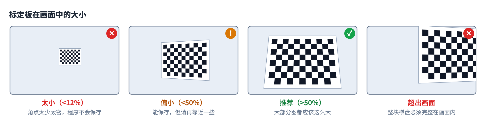

#### 程序判定“采够了”的标准（机器人实时采集）

下表全部满足、且总数达到要求后，程序自动结束采集并标定：

| 项目 | 要求 | 数量 |
|---|---|---|
| 正中正对 | 板在画面正中，倾斜 < 15° | 2 张 |
| 四角倾斜 | 板贴着画面的角（外框距两条边 < 12%，且**不碰到对边**），倾斜 ≥ 20°，靠画面角的一侧更靠近相机 | 每个角 2 张，共 8 张 |
| 四边 | 板贴着四条边的中间（外框距该边 < 12%），正对或倾斜均可 | 每条边 2 张，共 8 张 |
| 填满画面 | 板占画面 ≥ 65%，略带倾斜 | 2 张 |
| 左右倾斜 | 绕竖直轴倾斜 ≥ 20° | ≥ 4 张 |
| 上下倾斜 | 绕水平轴倾斜 ≥ 20° | ≥ 4 张 |
| 总张数 | | ≥ 20 张（最多 40 张） |

以下情况**不会保存**，画面会提示原因：板子不完整（ChArUco 板为检测到的角点不足）、占画面 < 12%、倾斜 > 50°、仍在移动、反光、模糊、与已保存的图几乎相同。

#### 推荐拍摄顺序

程序不规定顺序，提示总是指向“离当前位置最近、还缺的一项”。先把板拿到占画面 50% 以上的距离，整个过程基本保持这个距离，主要靠平移和倾斜，按下面的顺序走一遍：

1. **正中**：板正对相机放在画面中间，停稳，拍 2 张（第二张稍微换一点距离）
2. **四个角**：依次推到左上 → 右上 → 右下 → 左下，让板的两条边贴到画面边缘，并把**靠画面角的那一侧朝相机倾斜** 20°–35°：
   左上、右上角是上边靠近相机，左下、右下角是下边靠近相机。板的外角要顶到画面角。每个角 2 张。
   四个角拍完，上下倾斜也就够了
3. **左边、右边**：板贴到左边 / 右边中间，并让**靠这条边的一侧**朝相机倾斜 20°–35°，每处 2 张。拍完左右倾斜也就够了
4. **上边、下边**：板贴到上边 / 下边中间，每处 2 张
5. **填满画面**：再拿近一点，让板几乎占满画面并稍微倾斜，拍 2 张
6. **补缺**：看左侧“姿态分布”里还有哪些项是 ○，按画面提示补齐

> **为什么角上用上下倾斜、左右边用左右倾斜**：标定板比画面“方”，板很大时在角上做左右倾斜，靠近相机的那条边会变高，
> 容易碰到画面的对边，程序就不再把它算作“角”。上下倾斜时板在竖直方向变扁，更容易在角上同时做到“大”和“贴边”。
> 倾斜方向则按上面说的来：朝画面角的那一侧靠近相机，让板角顶到画面角。

> **鱼眼相机**：边缘和四角的畸变最大，更要把板推到画面最边上（标准棋盘格仍需完整可见）。边缘处的板看起来又小又弯是正常的，只要能检测到就有效。
> 板很难完整推到边缘时，可以改用 ChArUco 板。

#### 采集时看哪里

左侧 **角点与姿态分布** 实时显示进度：3×3 格子是画面 9 个位置已保存的张数（红 = 0 张，黄 = 不足，绿 = 已满足，蓝框 = 板当前所在位置）；
下方“姿态分布”是上表各项的完成情况；顶部显示当前板子占画面的比例和倾斜角。

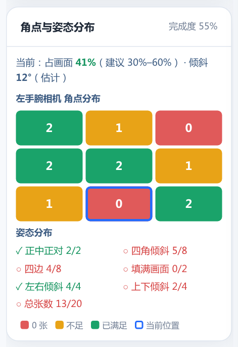

预览画面上的大字提示告诉你下一步做什么，颜色含义：**蓝 = 移动到某处 / 调整倾斜，黄 = 保持静止，绿 = 已保存，红 = 有问题**（看不到完整的板、太小、倾斜过大、反光）。

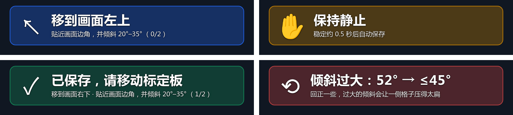

### 4.5 头部双目外参

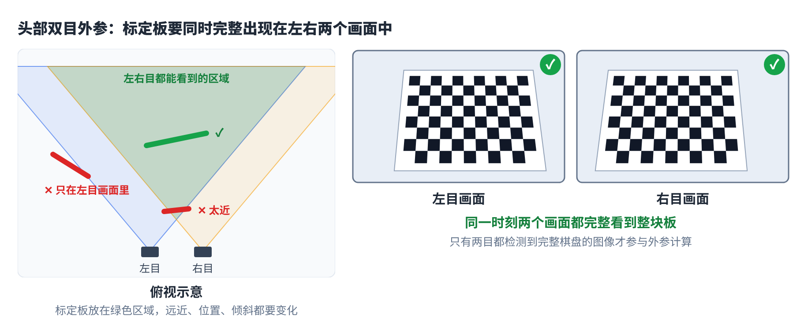

* 每一张都要让**整块板同时完整出现在左目和右目画面中**，只在一个画面里的图不参与外参计算
  （ChArUco 板允许部分出画：两目各自检测到 ≥30% 且 ≥8 个角点即可）
* 板放在两个相机都看得到的公共区域；离相机太近时板会超出其中一个画面
* 位置、倾斜、大小的要求和内参相同（进度按左目画面统计，左侧会同时显示左右目两个角点分布格子）
* 外参使用左右目已有的内参，所以要先把左目、右目的内参标好

### 4.6 手眼标定（眼在手上）

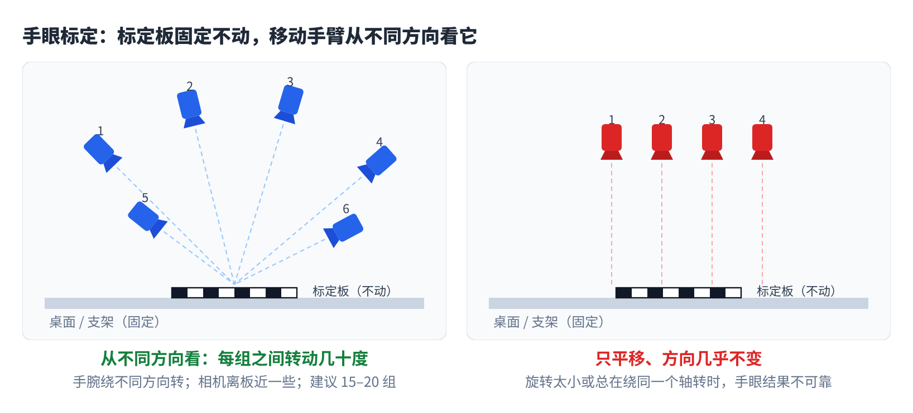

手眼标定是相机随手臂运动、标定板固定，**拍法与内参完全不同**：

* **标定板固定**在桌面或支架上，整个过程不能动；机器人底盘、机身也不能动
* **每组之间的转动要大**：相邻两组的手腕姿态相差几十度，而不是小幅晃动；所有组的总旋转跨度至少 30°，越大越好
* **转动方向要多样**：分别绕不同方向转手腕（上下俯仰、左右偏摆、绕相机视线旋转），并组合起来；如果总是绕同一个轴转，结果不可靠
* **只平移不转动的组几乎没有用**（见上图右侧）
* 相机在保证整块板完整可见、占画面 50% 以上的前提下**离板近一些**；板在画面中的位置也要有变化，尽量覆盖到画面边缘
* 开启“关节零位补偿”时，要让手臂的各个关节都有明显转动；左侧面板会显示哪些关节“请多转动”
* 每组点 **采集** 后松手、不要碰手臂，程序自动使能保持并采集；至少 15 组才能结束并标定（开启关节零位补偿时 20 组），建议 15–20 组

参考顺序：先让相机从正上方看板 → 依次向前 / 后 / 左 / 右倾斜手腕 20°–35° 各拍一组 → 在这些姿态上再绕视线方向旋转 ±30°–45° → 改变高度和位置重复，组合出不同方向的转动。

---

## 5、 🖥️ 界面总览

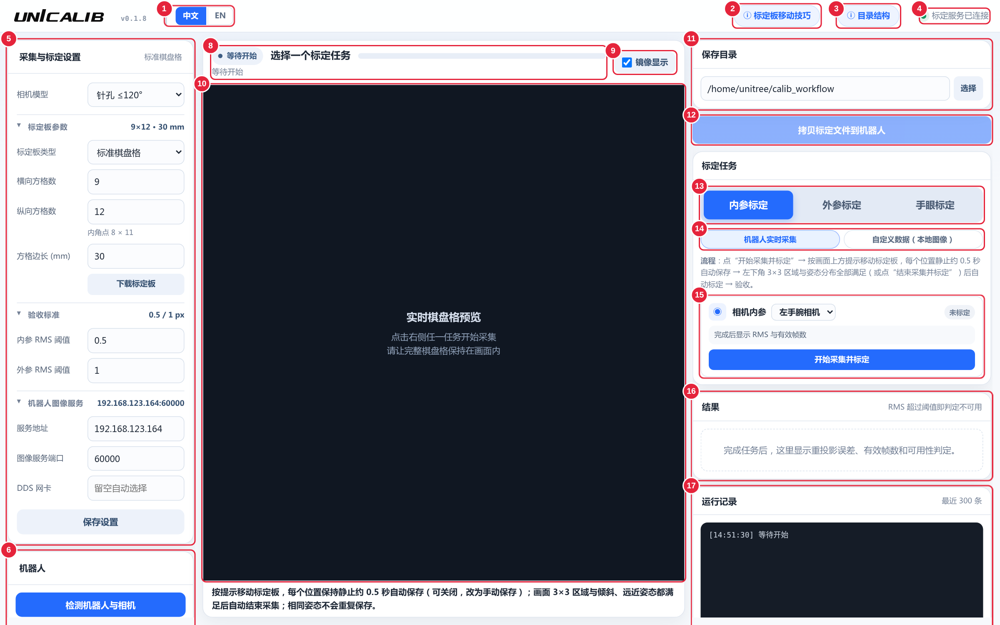

| 编号 | 区域 / 按钮 | 作用 |
|---|---|---|
| 1 | 中文 / EN | 切换界面语言 |
| 2 | ⓘ 标定板移动技巧 | 鼠标移上去查看：实时采集时标定板应该怎么移动、倾斜、远近 |
| 3 | ⓘ 目录结构 | 鼠标移上去查看：结果保存的目录结构，以及自定义数据（内参 / 外参 / 手眼）应该怎么准备 |
| 4 | 服务状态 | “标定服务已连接”（绿点）表示页面与本机 UNICALIB 程序连接正常；显示“服务连接失败”说明程序已退出，需重新启动 AppImage |
| 5 | 采集与标定设置 | 相机模型、标定板、验收标准、机器人图像服务，见第 6 节 |
| 6 | 机器人 | **检测机器人与相机**，并显示机器人编号与相机状态，见第 6 节 |
| 7 | 角点与姿态分布 | 实时采集时显示画面 3×3 区域的角点覆盖情况和标定板姿态（左右 / 上下倾斜、远近）是否采够 |
| 8 | 任务状态栏 | 当前阶段（等待开始 / 采集中 / 标定中 / 完成）、任务名称、进度条与提示信息 |
| 9 | 镜像显示 | 面对相机操作时勾选，画面和提示的左右与操作者一致；采集时这一栏还会出现更多按钮，见第 10 节 |
| 10 | 实时预览 | 显示相机画面、检测到的角点和大字移动提示；下方是操作说明 |
| 11 | 保存目录 | 所有标定结果的保存位置。可直接输入路径，或点 **选择** 打开目录选择窗口（见下图） |
| 12 | 拷贝标定文件到机器人 | 把本地标定结果写入机器人，见第 12 节。需先读取机器人编号，否则为灰色不可点 |
| 13 | 标定类型 | 内参标定 / 外参标定 / 手眼标定 |
| 14 | 数据来源 | **机器人实时采集**（连接机器人现场采集）/ **自定义数据（本地图像）**（使用已有图像） |
| 15 | 任务卡片 | 选择具体相机或手臂、查看状态（未标定 / 可用 / 不可用）、点按钮开始。13 和 14 的组合不同，卡片内容不同，见第 7–9 节 |
| 16 | 结果 | 任务完成后显示重投影误差（RMS / P95）、有效帧数和是否可用；手眼标定在这里有 **3D 查看** |
| 17 | 运行记录 | 本次运行的操作与提示日志（最近 300 条） |

### 目录 / 文件选择窗口

点击页面上任意 **选择** 按钮会打开这个窗口（浏览的是运行 UNICALIB 的这台电脑上的文件）：

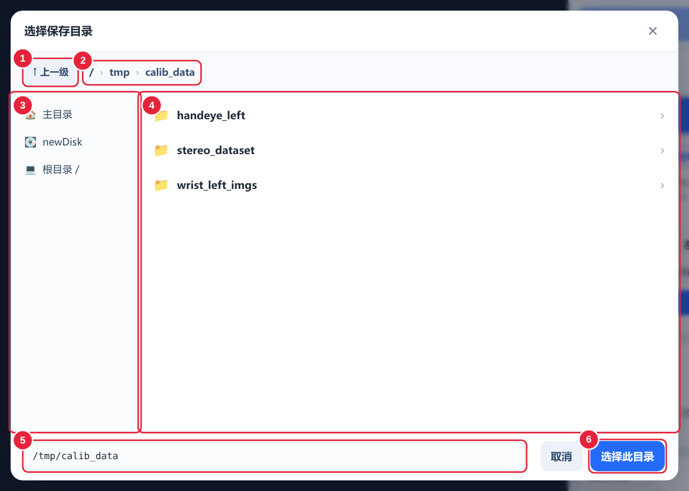

| 编号 | 作用 |
|---|---|
| 1 | 返回上一级目录 |
| 2 | 当前路径，点任意一级可直接跳转 |
| 3 | 常用位置：上次选择的目录、主目录、已挂载的磁盘、根目录 |
| 4 | 当前目录下的文件夹（选文件时也会列出可选的文件）；含图像的文件夹标出图像数量，符合外参数据格式的标出“外参数据根目录”。单击文件夹进入；选文件时单击文件即完成选择 |
| 5 | 直接输入路径，回车跳转 |
| 6 | 选择当前所在的目录 |

---

## 6、 🛠️ 开始前的设置（左侧）

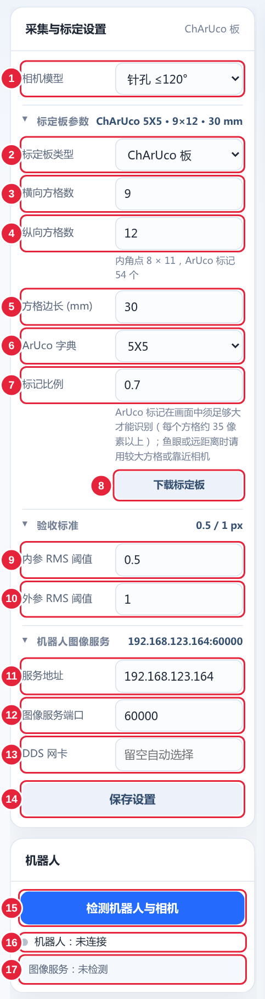

点击“标定板参数”“验收标准”“机器人图像服务”标题可展开 / 收起。截图为选择“ChArUco 板”时的界面；选择标准棋盘格时不显示 6、7 两项。

| 编号 | 设置 / 按钮 | 说明 |
|---|---|---|
| 1 | 相机模型 | 针孔 ≤120° / 鱼眼KB >120°，按镜头视场角选择。内参、外参都按此模型标定 |
| 2 | 标定板类型 | **标准棋盘格**（默认）或 **ChArUco 板**，区别见 4.2 节 |
| 3 | 横向方格数 | 按**方格**数填写，不是角点数。下方会提示对应的内角点数（方格数 − 1），ChArUco 板还会提示标记个数 |
| 4 | 纵向方格数 | 同上。标准棋盘格做外参标定时要求横纵方格数不同（如 9×12） |
| 5 | 方格边长 (mm) | 用尺子量实际打印出来的方格边长。决定外参 / 手眼平移的尺度，**务必填准** |
| 6 | ArUco 字典 | 仅 ChArUco 板：4X4 / 5X5 / 6X6 / 7X7，须与打印的板一致 |
| 7 | 标记比例 | 仅 ChArUco 板：ArUco 标记边长 / 方格边长（默认 0.7），须与打印的板一致 |
| 8 | 下载标定板 | 按上面的参数生成 1:1 真实尺寸的标定板 PDF（标准棋盘格或 ChArUco）；打印时选择“实际大小 / 100%”，不要缩放 |
| 9 | 内参 RMS 阈值 | 内参重投影误差超过该值判定为不可用（像素） |
| 10 | 外参 RMS 阈值 | 外参重投影误差超过该值判定为不可用（像素） |
| 11 | 服务地址 | 机器人 IP，即 TeleImager 图像服务所在地址（默认 `192.168.123.164`） |
| 12 | 图像服务端口 | TeleImager 图像服务的配置端口（默认 `60000`） |
| 13 | DDS 网卡 | 手眼标定时**本机**收发 DDS 关节数据用的网卡名（如 `eth0`、`enp3s0`），一般留空，自动选择本机连接机器人的那块网卡 |
| 14 | 保存设置 | 保存左侧所有设置，下次启动自动沿用 |
| 15 | 检测机器人与相机 | 连接机器人：首次会弹窗输入 SSH 账号密码，然后读取机器人编号、检测图像服务中的相机及实际分辨率 / 帧率 |
| 16 | 机器人状态 | 显示是否已连接及机器人编号 |
| 17 | 图像服务状态 | 显示图像服务是否可用；检测成功后可展开“详细信息”查看每路相机 |

---

## 7、 📷 内参标定

### 7.1 机器人实时采集

标定类型选 **内参标定**，数据来源选 **机器人实时采集**：

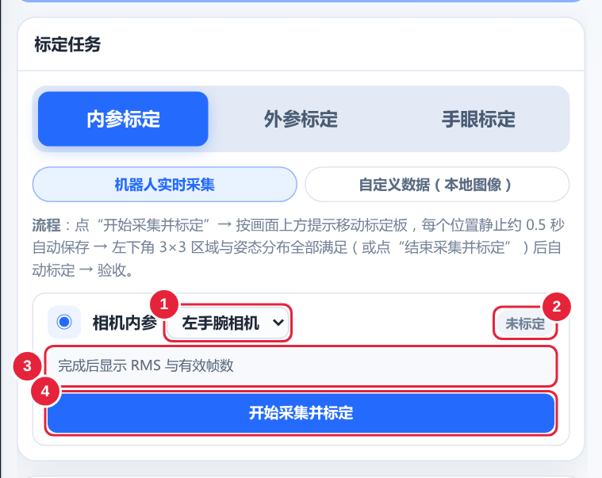

| 编号 | 作用 |
|---|---|
| 1 | 选择要标定的相机：左手腕相机 / 右手腕相机 / 左目相机 / 右目相机 |
| 2 | 该相机的状态：未标定 / 采集中 / 可用 / 不可用 |
| 3 | 上次标定的结果（RMS、P95、帧数），采集中显示已采集帧数 |
| 4 | **开始采集并标定**：连接图像服务开始采集，按画面提示移动标定板（拍法见第 4 节），采够后自动标定并验收 |

### 7.2 自定义数据

标定类型选 **内参标定**，数据来源选 **自定义数据（本地图像）**：

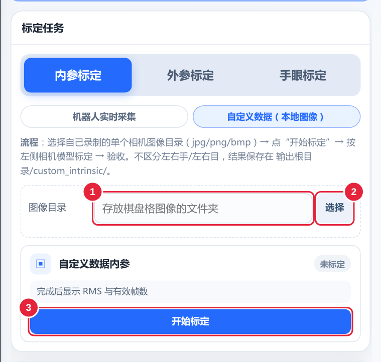

| 编号 | 作用 |
|---|---|
| 1 | 图像目录：存放同一台相机拍摄的标定板图像的文件夹（建议 20–40 张，拍法按第 4 节） |
| 2 | 选择：打开目录选择窗口 |
| 3 | **开始标定**：按左侧的相机模型和标定板参数标定，完成后在“结果”中显示验收结论 |

> 自定义数据（内参 / 外参 / 手眼）支持的图像格式：`.jpg`、`.jpeg`、`.png`、`.bmp`（扩展名不区分大小写）。
> 只读取所选目录下直接存放的图像，不读取子目录。

---

## 8、 🔭 外参标定

### 8.1 头部双目（机器人实时采集）

标定类型选 **外参标定**，数据来源选 **机器人实时采集**：

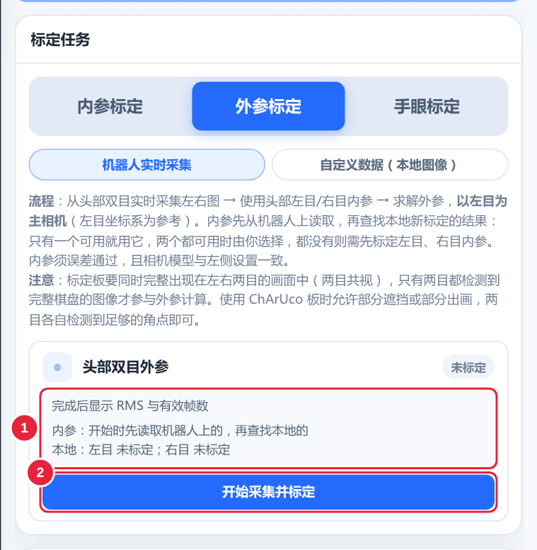

| 编号 | 作用 |
|---|---|
| 1 | 上次结果，以及本地左目 / 右目内参的状态 |
| 2 | **开始采集并标定** |

* 以**左目为主相机**，需要先有可用的左目、右目内参
* 程序会同时查找机器人上已有的内参和本地最新的内参：
  只有一个可用就直接使用；两个都可用会弹窗让你选择；都没有则提示先标定左目、右目内参
* 点开始后，按提示移动标定板，使其同时出现在左右两个画面中；只有两目都检测到棋盘（标准棋盘格须完整，ChArUco 板须足够多角点）的图像才参与计算

### 8.2 自定义数据

标定类型选 **外参标定**，数据来源选 **自定义数据（本地图像）**：

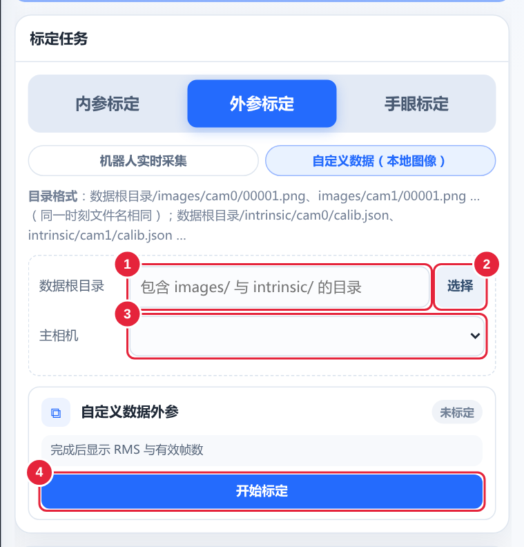

| 编号 | 作用 |
|---|---|
| 1 | 数据根目录（格式见下） |
| 2 | 选择：打开目录选择窗口；选好后自动识别其中的相机 |
| 3 | 主相机：外参结果为其他相机 → 主相机的变换 |
| 4 | **开始标定** |

数据根目录格式如下（同一时刻的图像文件名相同）：

```
数据根目录/
├─ images/cam0/00001.png, images/cam1/00001.png, …
└─ intrinsic/cam0/calib.json, intrinsic/cam1/calib.json, …   （可选）
```

* 自动识别 `images/` 下的 `cam*` 子目录（至少 2 个），可选择主相机（默认编号最小的相机）
* 内参：每个相机读取 `intrinsic/cam*/calib.json`（没有 `calib.json` 时，目录中只有一个 `.json` 也可）
* **缺少内参的相机会先用它自己的图像自动标定内参**（使用页面上当前选择的相机模型），再标定外参；
  `intrinsic/` 目录整个省略也可以，此时所有相机都自动标定内参

> 标定板上**不需要**红色标记。

---

## 9、 🦾 手眼标定（眼在手上）

目前只支持**眼在手上**（相机装在手腕上，标定板固定）。

### 9.1 准备

* **标定板固定不动**，底盘不要移动
* 准备好机器人的 URDF 文件：本仓库 [`urdf/`](urdf/) 下提供 G1（29 自由度）、G1_D 与 R1-A7-D，机型对应关系见第 1 节表格。G1 锁腰版本暂不支持
* 先完成对应腕部相机的**内参标定并拷贝到机器人**（手眼标定会从机器人 `/home/unitree/calib/uniclib_calibration.json` 读取腕部内参）
* **建议用网线连接机器人**：关节数据与使能保持指令在本机经 DDS 收发，0.3 秒收不到关节数据时保持会自动释放
* **G1**：标定时机身必须固定（吊起或靠稳），使能保持期间腿部不受控制
* **R1-A7-D**：
  * 开始标定时程序会先让机器人**进入调试模式**（手臂可能卸力，请先扶好或放在安全位置）；结束后**不会自动退出调试模式**，需要恢复正常运控时请重启机器人
  * 升降必须已回零，否则会提示不能标定

### 9.2 机器人实时采集

标定类型选 **手眼标定**，数据来源选 **机器人实时采集**：

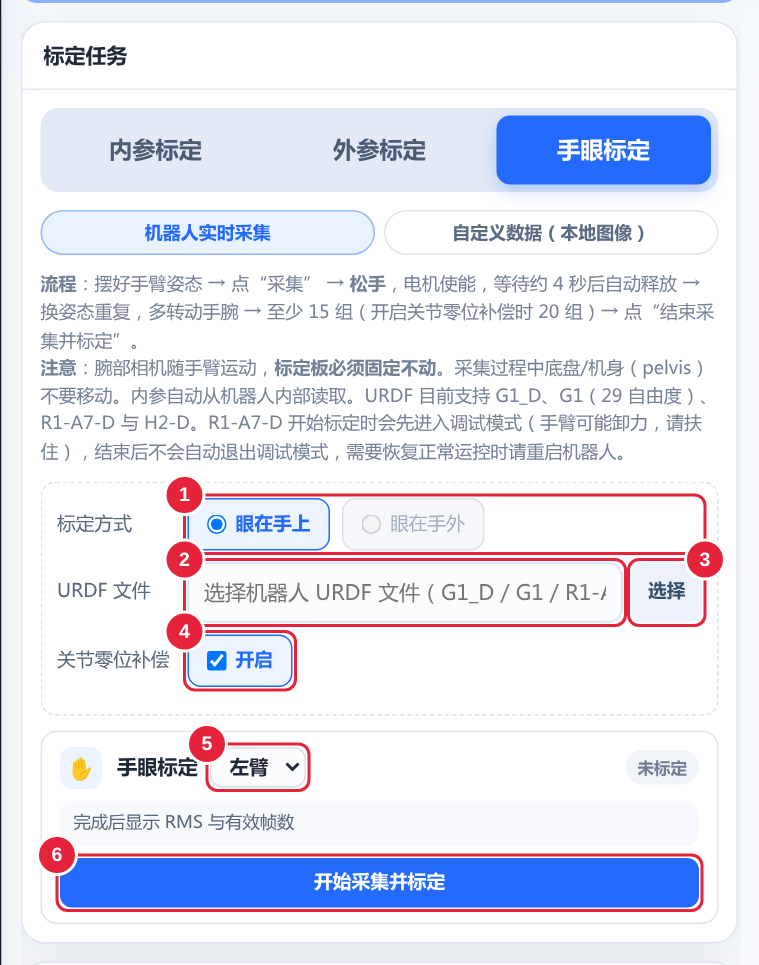

| 编号 | 作用 |
|---|---|
| 1 | 标定方式：眼在手上（相机装在手腕上，标定板固定）；“眼在手外”暂不支持 |
| 2 | URDF 文件：机器人的 URDF 路径（G1_D / G1 29 自由度 / R1-A7-D） |
| 3 | 选择：打开文件选择窗口，选择 `.urdf` 文件 |
| 4 | 关节零位补偿：同时估计关节零位偏差（默认开启，需至少 20 组） |
| 5 | 选择手臂：左臂 / 右臂 |
| 6 | **开始采集并标定**：开始后进入逐组采集，用页面上方的 **采集** 按钮采每一组（见第 10 节） |

步骤：

1. 选好 URDF 和手臂，点 **开始采集并标定**；页面先显示按 URDF 识别出的机器人型号与运动链，确认后才开始采集
2. 手动把手臂摆到一个姿态，使标定板完整出现在腕部相机画面中
3. 点页面上方的 **采集** 按钮，然后**松手**：程序让这只手臂原地使能保持，稳定后采集约 1 秒，再自动释放（共约 4 秒）
   **采集期间请勿触碰机械臂。**
4. 重复第 2–3 步，每组之间转动几十度、绕不同方向转（总旋转跨度 ≥ 30°）
5. 至少 15 组才能结束并标定（开启关节零位补偿时 20 组），建议 15–20 组；姿态怎么选见 4.6 节
6. 采集不合格（抖动 / 漂移过大、标定板检测不到）时不会保存，并显示原因；可点 **撤销上一组**

> 使能保持的安全措施：使能前检查没有其他程序在控制手臂；增益渐升；关节偏离过大或速度过快、关节数据中断、本程序退出、点击停止时都会立即释放。

### 9.3 自定义数据

标定类型选 **手眼标定**，数据来源选 **自定义数据（本地图像）**：

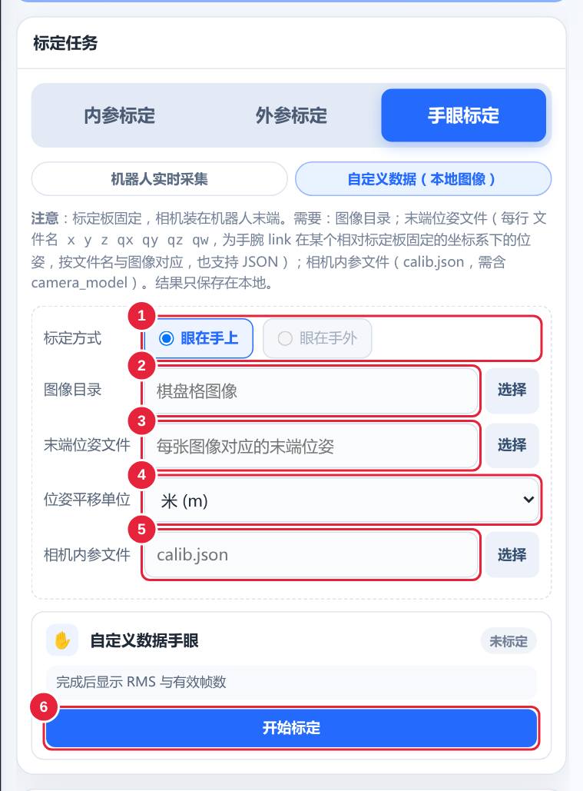

| 编号 | 作用 |
|---|---|
| 1 | 标定方式：眼在手上 |
| 2 | 图像目录：腕部相机拍摄的标定板图像（标定板固定不动） |
| 3 | 末端位姿文件：每张图像对应的手腕位姿（格式见下） |
| 4 | 位姿平移单位：米 (m) / 毫米 (mm) |
| 5 | 相机内参文件：`calib.json`，需含 `camera_model` |
| 6 | **开始标定**；结果只保存在本地 |

2、3、5 右侧的 **选择** 按钮用于打开选择窗口。

位姿文件按文件名与图像对应，二选一：
* 文本：每行 `文件名 x y z qx qy qz qw`（逗号或空格分隔，`#` 为注释，平移单位 m 或 mm）
* JSON：`{"000001": 4×4 矩阵 | [x,y,z,qx,qy,qz,qw] | {"position", "quaternion"}}`

### 9.4 查看结果

验收结果中的 **3D 查看** 可显示机器人、标定得到的相机位置和视场、标定板，并可逐组切换采集姿态，与真实机器人对照。

> 若开启了关节零位估计并使用补偿后的结果，正运动学须使用 **实际关节角 = 读数 + 零位**。

### 9.5 其他机器人

“机器人实时采集”需要知道每个关节的数据从哪里读（lowstate 电机编号、升降 / 腰部的话题）以及如何使能保持手臂，
这些按机型写在程序里，目前只有 **G1_D、G1（29 自由度）与 R1-A7-D**。

* **怎么识别**：先按 URDF 的 `<robot name>` 认机型，再逐个核对 `<base_link> → <左/右>_wrist_yaw_link` 上可动关节的个数、类型与转轴；
  名称认不出时只按关节逐个机型匹配
* **其他机器人**（包括 G1 锁腰版本、G1 23 自由度，以及其他型号）：开始前就会提示“所选 URDF … 与支持的机器人型号都不一致”
  或“关节核对未通过”，**不能开始采集**，也不会连接或驱动机器人
* **可以用“自定义数据”标定**（9.3 节），这种方式与机器人型号无关：
  1. 标定板固定，手臂摆到不同姿态（要求同 4.6 节），每个姿态用腕部相机拍一张图，同时记录手腕（末端）在机器人基座坐标系下的位姿
     （用该机器人自己的 SDK / 正运动学计算），按 9.3 节的格式写成位姿文件
  2. 准备好该腕部相机的内参文件 `calib.json`（可先用“内参标定”得到）
  3. 选择图像目录、位姿文件、平移单位和内参文件，点 **开始标定**；结果保存在本地 `handeye/custom/<时间>/handeye.json`，
     不会自动拷贝到机器人
* 需要为新机型支持“机器人实时采集”时，要在程序中增加该机型的配置（关节与 lowstate 编号对应、升降 / 腰部话题、使能保持增益等）
  并重新发布 AppImage，请联系开发者

---

## 10、 ⏺️ 实时采集时的按钮

开始实时采集后，预览画面上方会出现以下按钮（不同任务只显示其中一部分）：

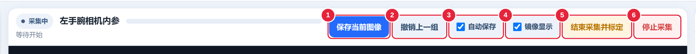

| 编号 | 按钮 | 作用 |
|---|---|---|
| 1 | 保存当前图像 | 内参 / 外参：手动保存当前这一帧（自动保存关闭时只能用它）。手眼标定时变为 **采集（约 1 秒）**，每点一次采一组 |
| 2 | 撤销上一组 | 仅手眼标定：删除最近保存的一组 |
| 3 | 自动保存 | 勾选：标定板静止约 0.5 秒自动保存；取消：只能手动点 1 保存 |
| 4 | 镜像显示 | 面对相机操作时勾选，画面左右与操作者一致 |
| 5 | 结束采集并标定 | 不再等待自动结束，用已采集的图像立即标定 |
| 6 | 停止采集 | 放弃本次采集，**不进行标定**（标定开始后不能停止） |

### 采集中的提示

* 画面上方大字提示下一步：蓝 = 移动到某处 / 调整倾斜，黄 = 保持静止，绿 = 已保存，红 = 有问题（看不到完整的板、太小、倾斜过大、反光）
* 每个位置**静止约 0.5 秒**自动保存；与已保存图像太相似的不会重复保存
* 左侧 **角点与姿态分布** 全部满足后自动结束并标定；也可随时点 **结束采集并标定**
* 标定板怎么拿、要拍哪些位置和角度，见**第 4 节**

---

## 11、 ✅ 验收结果

每个任务显示 **RMS** 与 **P95**（重投影误差的 95 分位）以及参与帧数，全部检查通过才标记为 **可用**。

手眼标定的默认验收标准：重投影 ≤ 5 px、标定板位置一致性 ≤ 10 mm、旋转一致性 ≤ 1°、≥ 15 组、旋转跨度 ≥ 30°。

---

## 12、 📤 拷贝标定结果到机器人

先在左侧点“检测机器人与相机”读取机器人编号，然后点右侧“标定任务”上方的 **拷贝标定文件到机器人** 按钮：

1. 程序读取机器人上已有的 `/home/unitree/calib/uniclib_calibration.json`
2. 与本地最新结果逐项对比 RMS 与 P95；机器人上的结果明显更好时会标红提示，并默认保留
3. 每项可选择“用本地新结果 / 保留机器人现有”
4. 点 **按所选组合并拷贝**，合并为一个文件写入机器人，旧文件自动备份为 `uniclib_calibration.<时间>.json`

* 写入前会再次核对机器人编号，不一致则取消
* 若头部双目外参所用的内参与将要写入的左右目内参不一致（例如外参用了本地内参、内参却选择保留机器人旧结果），对话框会提示并在拷贝前再确认一次

---

## 13、 📁 结果保存在哪里

```
<保存目录>/
├─ <机器人编号>/                       每台机器人一个目录（实时采集）
│  ├─ device.json                      机器人信息
│  ├─ images/<相机>/<时间>/            采集的图像
│  ├─ intrinsic/<相机>/<时间>/calib.json, quality.json
│  ├─ extrinsic/head_stereo/…
│  ├─ handeye/<left_arm|right_arm>/…
│  └─ uniclib_calibration.json         最近一次拷贝到机器人的合并文件
├─ intrinsic/custom/                   自定义数据内参
├─ extrinsic/custom/                   自定义数据外参
└─ handeye/custom/<时间>/handeye.json  自定义数据手眼
```

机器人编号格式为 `Jetson模组序列号_eth0 MAC`，连接机器人时自动读取。

`calib.json` 主要字段：`camera_model`（`Pinhole` / `Fisheye`，Fisheye 即 Kannala-Brandt KB4）、`image_size`（[高, 宽]）、`intrinsic`（fx, fy, cx, cy + 畸变系数）、`rms_reproj_err_px`。

合并文件 `uniclib_calibration.json` 中的 `handeye` 段包含 `T_wrist_cam`（参考 link 为 `<left|right>_wrist_yaw_link`）和关节零位。

### 设置与日志

| 内容 | 位置 |
|---|---|
| 网页设置 | `~/.config/uniclib/`（可用环境变量 `UNICLIB_CONFIG_DIR` 修改） |
| 日志 | `~/.config/uniclib/logs/uniclib.log` |

页面上的错误提示带有错误编号，反馈问题时请附上该编号和日志文件。

---

## 14、 ❓ 常见问题

| 现象 | 处理 |
|---|---|
| 运行 AppImage 没反应 | 在终端运行查看输出；缺少 FUSE 时加 `--appimage-extract-and-run` |
| 端口被占用 | 会自动换到下一个可用端口，以终端打印的地址为准 |
| 提示无法连接图像服务 | 确认机器人上 TeleImager 服务在运行；检查左侧服务地址 / 端口，或点“检测机器人与相机” |
| 检测不到某路相机 | 检查机器人上 TeleImager 的相机配置（见 TeleImager 项目说明） |
| 提示“机器人上的 TeleImager 是 v2.1.0 及之后的版本……目前不支持”，或所有相机都检测不到 | 机器人上的 TeleImager 是 v2.1.0 及之后的版本（目前不支持），按 3.1 节换成提交 `940fd69` 的版本，并用该版本格式的配置文件 |
| 手眼标定提示“所选 URDF … 与支持的机器人型号都不一致”或“关节核对未通过” | 机器人型号不在支持列表中（或 URDF 选错），见 9.5 节 |
| 提示“尚未读取机器人编号” | 检查能否 SSH 连接机器人，或点“检测机器人与相机” |
| 外参提示内角点需非正方形 | 换用行列方格数不同的棋盘格（如 9×12），或改用 ChArUco 板 |
| ChArUco 板检测不到 / 角点不足 | 确认 ArUco 字典、标记比例、方格数与打印的板一致（建议用“下载标定板”生成的 PDF）；让板靠近相机或换用更大方格（每个方格约 35 像素以上） |
| 头部双目提示没有可用内参 | 先标定头部左目、右目内参（误差通过、相机模型与当前设置一致） |
| 手眼标定提示没有腕部内参 | 先完成腕部内参标定并拷贝到机器人 |
| 手眼标定读不到关节数据 / 保持频繁释放 | 确认电脑与机器人在同一网段、用网线连接；必要时在“DDS 网卡”中填写本机连接机器人的网卡名 |
| R1-A7-D 标定后机器人不能正常运控 | 标定时进入了调试模式且不会自动退出，重启机器人即可 |
| R1-A7-D 提示升降未回零 | 先让升降回零后再开始手眼标定 |
| 一直不自动结束采集 | 按提示补齐缺少的区域或姿态，或点“结束采集并标定” |
| 拷贝时提示机器人编号不一致 | 当前连接的不是这些结果对应的机器人，确认地址后重新读取编号 |
| 结果“不可用”或误差偏大 | 按第 4 节检查：四角 / 四边是否覆盖、左右和上下倾斜是否都有、板是否平整无反光、方格边长是否填准；补拍后重新标定 |
| 标定失败并显示错误编号 | 检查标定板参数与相机模型，增加不同位置 / 角度 / 远近的图像后重试 |

---

## 📋 TODO

- ⬜ 眼在手外（eye-to-hand）手眼标定
- ⬜ 支持更多系统（如 Ubuntu 20.04 等更低 glibc 版本）

## 🙏 致谢

本工具使用或参考了以下开源项目，相关许可证请参考各项目：

1. three.js：https://github.com/mrdoob/three.js
2. FastAPI：https://github.com/fastapi/fastapi
3. unitree_sdk2_python：https://github.com/unitreerobotics/unitree_sdk2_python
4. Eclipse Cyclone DDS：https://github.com/eclipse-cyclonedds/cyclonedds-python
5. TeleImager：https://github.com/unitreerobotics/teleimager
6. unitree_ros（G1 URDF）：https://github.com/unitreerobotics/unitree_ros
