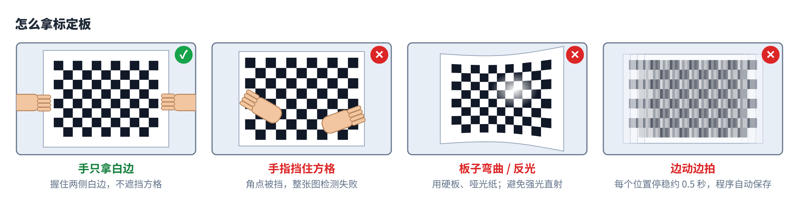
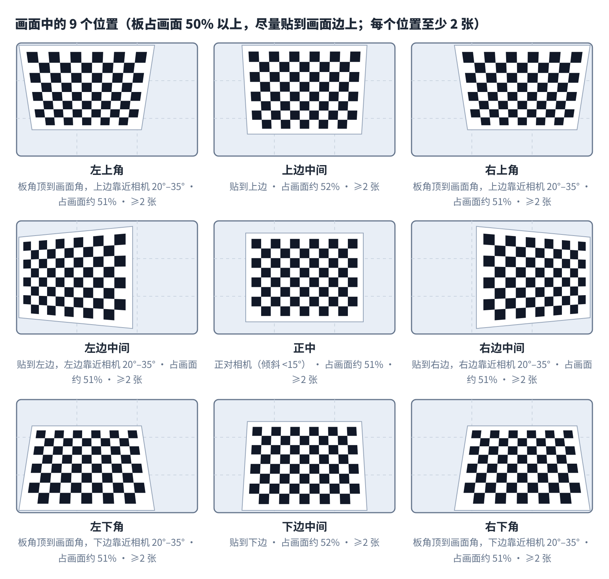
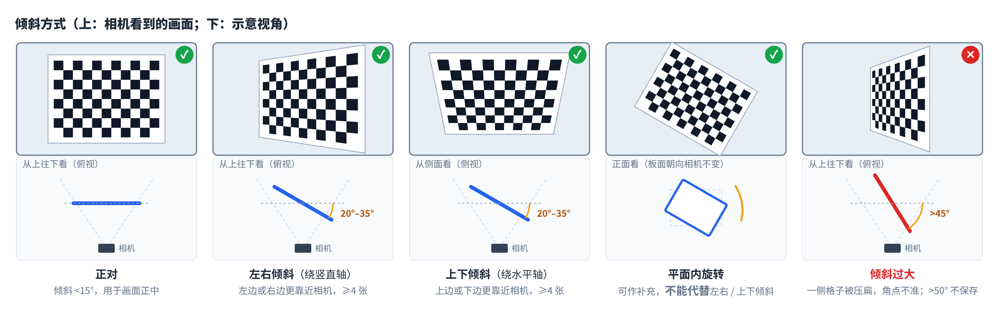

<div align="center">
  <h1 align="center"> UNICALIB </h1>
  <h3 align="center"> Unitree Robotics </h3>
  <p align="center">
    <a href="README.md"> English </a> | <a >中文</a>
  </p>
  <p align="center">
    
    
  </p>
</div>

## 1、 📖 介绍

UNICALIB 是宇树（Unitree）机器人相机标定工作台：在浏览器中操作，按画面提示移动标定板，程序自动挑选图像、自动标定并给出验收结论，结果可一键拷贝到机器人。

* **内参标定**：左手腕 / 右手腕 / 头部左目 / 头部右目相机，或自定义图像目录
* **外参标定**：头部双目，或自定义多相机数据
* **手眼标定**（眼在手上）：左臂 / 右臂腕部相机，或自定义数据
* **相机模型**：**针孔**（视场角 ≤120°，OpenCV k1, k2, p1, p2, k3）与 **鱼眼KB**（视场角 >120°，Kannala-Brandt KB4，与 OpenCV `cv2.fisheye` 一致）
* **标定板**：**标准棋盘格**，或 **ChArUco 板**，均可在页面上生成 1:1 PDF格式的文件
* 标定结果自动验收，结果面板、手眼 **3D 查看**，并可一键**拷贝到机器人**
* 界面支持 **中文 / English** 切换

手眼标定（机器人实时采集）支持的机型：

| 机型 | URDF（本仓库 `urdf/`） | 运动链（自动计入正运动学） | 说明 |
|---|---|---|---|
| G1_D | `g1_d_description/g1_d.urdf` | `AGV_link` → 升降 → 腰部俯仰 → 腰部左右转 → 手臂 | 轮式底盘，底盘不要移动 |
| G1（29 自由度） | `g1_description/g1_29dof_rev_1_0.urdf` | `pelvis` → 腰 yaw / roll / pitch → 手臂 | 机身必须固定（吊起或靠稳）；锁腰版本暂不支持 |
| R1-A7-D | `r1_d_description/r1_d_with_dex1_1.urdf` | `base_link` → 升降 → 腰部左右转 → 手臂 | 开始时进入零力距模式；|

不能用“机器人实时采集”做手眼标定的机器设备，可以用“自定义数据”，见 9.5 节。

---

## 2、 ⚙️ 安装与启动

### 2.1 发布包内容

```
uni_clib/
├─ UNICALIB-0.1.7-x86_64.AppImage          标定工作台（单文件，免安装）
├─ UNICALIB-0.1.7-x86_64.AppImage.sha256   校验和
├─ urdf/                                   手眼标定用 URDF 与网格（G1 / G1_D / R1-A7-D），见 urdf/README_zh-CN.md
├─ docs/images/                            本说明使用的图片（en/ 为英文界面版本）
├─ README.md                               英文说明
└─ README_zh-CN.md                         中文说明（本文件）
```

### 2.2 启动

```bash
sudo apt install git-lfs
git lfs install
git clone https://github.com/unitreerobotics/uni_calib.git
cd uni_calib
git lfs pull
sha256sum -c UNICALIB-0.1.7-x86_64.AppImage.sha256   # 可选：校验下载是否完整
chmod +x UNICALIB-0.1.7-x86_64.AppImage
./UNICALIB-0.1.7-x86_64.AppImage #或者双击AppImage
```

如需获取指定版本：

```bash
sudo apt install git-lfs
git lfs install
git clone https://github.com/unitreerobotics/uni_calib.git
cd uni_calib
git fetch --tags
git checkout v0.1.7
git lfs pull

chmod +x UNICALIB-0.1.7-x86_64.AppImage
./UNICALIB-0.1.7-x86_64.AppImage    #或者双击AppImage
```

### 2.3 系统要求

* x86_64 Linux，glibc ≥ 2.35（Ubuntu 22.04 及以上）
* 不需要安装 Python 或其他依赖（手眼标定所需的 `unitree_sdk2py` 与 cyclonedds 已打包在内）
* 机器人实时采集时，机器人上需运行 TeleImager 图像服务，见第 3 节

### 2.4 退出

终端按 `Ctrl+C`；或关闭所有页面，程序约几秒后自动退出。

---

## 3、 🤖 机器人端准备（与机器人联合标定时必需）

UNICALIB 本身不在机器人上运行，而是从电脑通过网络读取机器人相机的图像。
因此，**机器人上必须安装并运行 [TeleImager](https://github.com/unitreerobotics/teleimager) 图像服务**。

使用“自定义数据”标定已有图像时，不需要这一步。

### 3.1 TeleImager

UNICALIB 与 TeleImager 提交 [`940fd69`](https://github.com/unitreerobotics/teleimager/commit/940fd69616d1a32f2985a4da65d9ae3700780175) 的版本配套（v2.0.8 之后、v2.1.0 之前）：
向配置端口（默认 60000）请求相机配置，再按每路相机配置中的 `enable_zmq` / `zmq_port` 订阅 JPEG 图像。

> ⚠️ **TeleImager v2.1.0 及之后的最新版本目前不支持**：v2.1.0 修改了相机配置格式（`zmq_port` → `color_zmq_port`、
> `enable_zmq` → `enable_color_zmq` 等），UNICALIB 读不到相机端口；识别到这种格式时会提示“机器人上的 TeleImager 是 v2.1.0 及之后的版本……目前不支持”。

在机器人上按指定提交从源码安装（不要用 `pip install teleimager`，PyPI 上是最新版）：

```bash
git clone https://github.com/unitreerobotics/teleimager.git
cd teleimager
git checkout 940fd69616d1a32f2985a4da65d9ae3700780175
pip install -e ".[server]"        # 按相机后端选择，如 ".[uvc]"、".[all]"
```

之后的配置（相机名称、端口、分辨率等）、启动和开机自启，按**该提交版本**的[说明文档](https://github.com/unitreerobotics/teleimager/tree/940fd69616d1a32f2985a4da65d9ae3700780175)操作。
配置文件 `~/.config/teleimager/teleimager_server.yaml` 须使用该版本的格式（每路相机含 `enable_zmq`、`zmq_port`）；
如果机器人上装过 v2.1.0 及之后的版本，请按该版本的模板 `src/teleimager/teleimager_server.yaml` 重新填写。

相机名称：头部双目用 `head_camera`（或 `head_stereo_camera`，左右并排、`binocular: true`），
左右腕部用 `left_wrist_camera` / `right_wrist_camera`（或 `wrist_left_camera` / `wrist_right_camera`），两种命名都能识别。

### 3.2 网络与登录

* 电脑与机器人在同一网络，能访问机器人 IP（默认 `192.168.123.164`）
* 机器人开启 SSH：UNICALIB 用它读取机器人编号等信息，以及把标定结果写入机器人 `/home/unitree/calib/`
* 手眼标定时，关节角读取与手臂使能保持都**在本机经 DDS 收发**，机器人上不需要运行或安装额外程序；
  因此电脑需与机器人处于同一 DDS 网络（如 `192.168.123.x` 网段），**建议用网线连接**（保持指令以 250 Hz 发送，无线丢包会影响保持）

### 3.3 检查连接

1. 在机器人上确认 TeleImager 服务已启动（方法见 [TeleImager](https://github.com/unitreerobotics/teleimager) 项目说明）
2. 打开 UNICALIB，在左侧“机器人图像服务”填写机器人 IP 和配置端口（默认 `192.168.123.164` / `60000`）
3. 点 **检测机器人与相机**：首次会要求输入机器人 SSH 账号密码（只保存在程序内存中，退出即清除）；成功后会显示机器人编号、各路相机及其实际分辨率和帧率

---

## 4、 🎯 标定板与拍摄姿态（重要）

标定结果准不准，**主要取决于采集的图像**：重投影误差再小，姿态单一、没覆盖到画面边角，结果照样不可靠。
实时采集时程序会逐项检查并提示；用自定义数据时请自己按本节拍摄。

### 4.1 拍摄原则

| 要求 | 原因 |
|---|---|
| **覆盖画面四角和四边**，板尽量贴到画面边上 | 畸变从中心向外增大，只有边缘角点能约束畸变；没拍到的区域结果就是“猜”的 |
| **左右、上下都要倾斜**，不超过 45° | 焦距和主点只能从透视缩短中求出；全部正对相机求不准焦距；倾斜太大则角点定位变差 |
| **每张姿态都不同** | 只平移不转动的图没有新信息；20 张各不相同的图好过 100 张相似的 |
| 板**占画面 50% 以上** | 角点越多、分布越广，约束越强 |
| 板**平整、不反光、停稳后拍** | 弯曲、反光、模糊会让角点出错，误差直接进入结果 |

### 4.2 准备标定板

* 在左侧设置（见第 6 节）选好板类型、填好方格数和边长，点 **下载标定板** 生成 1:1 PDF，打印选“实际大小 / 100%”
* 打印后**用尺子量方格边长**，按实测值填写
* 贴在**硬而平**的板上，用**哑光**纸；外圈留**至少一个方格宽的白边**；光照均匀，避免强光和阴影；拍摄过程中不要改变对焦和分辨率
* 标准棋盘格做外参时横纵方格数必须不同（如 9×12）；ChArUco 无此要求

**标准棋盘格 or ChArUco？**

| | 标准棋盘格（默认） | ChArUco 板 |
|---|---|---|
| 遮挡 / 出画 | 不允许，整块板必须完整可见 | 内参 / 外参允许：每个画面检测到 ≥30% 且 ≥8 个角点即可 |
| 识别距离 | 较远也能识别 | 每个方格在画面中需约 **35 像素以上** |
| 适合 | 一般情况 | 鱼眼边缘、双目公共视野小、板难以完整入画时 |

* 用 ChArUco 时，页面上的 **ArUco 字典**和 **标记比例**（默认 0.7）必须与打印的板一致，**建议直接用“下载标定板”生成的 PDF 打印**

### 4.3 怎么拿



* **双手只拿两侧白边**，手指不要挡住方格（标准棋盘格任何一个角点被挡住，整张图都检测不到）
* **每换一个位置就停稳约 0.5 秒**，程序检测到静止后自动保存（提示变绿），再移到下一个位置
* 相机固定、人拿着板移动；面对相机操作时勾选 **镜像显示**，画面左右就和你的左右一致
* 距离接近实际工作距离并有远近变化：太远角点太小，太近容易失焦或出画

### 4.4 内参：要拍哪些姿态

**① 9 个位置**：正中正对相机；四个角、四条边都要**把板推到贴着画面边缘**，且占画面 50% 以上。每个位置至少 2 张（换个倾斜角度再拍）。

**在角上时，让靠画面角的那一侧更靠近相机**（左上、右上角是上边靠近相机，左下、右下角是下边靠近相机；左右两边是靠边的一侧靠近相机），这样板的外角才能顶到画面角。反过来倾斜，角落的角点就会缺一块。



**② 倾斜方式**：左右倾斜和上下倾斜**都要有**，主要在 20°–35°，不超过 45°。平面内旋转只能补充，**不能代替**倾斜。



**③ 大小**：每张都让板**占画面 50% 以上**，其中至少 2 张几乎填满（≥65%）且略带倾斜；标准棋盘格必须**完整**在画面内。


#### 程序判定“采够了”的标准（机器人实时采集）

下表全部满足、总数达标后，程序自动结束采集并标定：

| 项目 | 要求 | 数量 |
|---|---|---|
| 正中正对 | 板在画面正中，倾斜 < 15° | 2 张 |
| 四角倾斜 | 板贴角（外框距两条边 < 12%，且**不碰到对边**），倾斜 ≥ 20°，靠角一侧更近 | 每角 2 张，共 8 张 |
| 四边 | 板贴边中间（外框距该边 < 12%），正对或倾斜均可 | 每边 2 张，共 8 张 |
| 填满画面 | 占画面 ≥ 65%，略带倾斜 | 2 张 |
| 左右 / 上下倾斜 | 绕竖直轴 / 水平轴倾斜 ≥ 20° | 各 ≥ 4 张 |
| 总张数 | | ≥ 20 张（最多 40 张） |

**不会保存**的情况（画面会提示原因）：板不完整、占画面 < 12%、倾斜 > 50°、仍在移动、反光、模糊、与已保存的图几乎相同。

#### 推荐拍摄顺序

先把板拿到占画面 50% 以上的距离，全程基本保持，主要靠平移和倾斜：

1. **正中**：正对相机，停稳拍 2 张
2. **四个角**：左上 → 右上 → 右下 → 左下，板的两条边贴到画面边缘，**靠角一侧朝相机倾斜** 20°–35°，每角 2 张（拍完上下倾斜就够了）
3. **左、右边**：板贴边中间，靠边的一侧朝相机倾斜 20°–35°，每处 2 张（拍完左右倾斜就够了）
4. **上、下边**：板贴边中间，每处 2 张
5. **填满画面**：拿近一点，几乎占满并略带倾斜，2 张
6. **补缺**：看左侧“姿态分布”里还有哪些是 ○，按提示补齐

> 角上用上下倾斜、左右边用左右倾斜：板比画面“方”，在角上做左右倾斜时靠近相机的那条边会变高、碰到对边，程序就不再算作“角”。

> **鱼眼相机**：四角畸变最大，更要把板推到最边上；边缘处的板看起来又小又弯是正常的，能检测到就有效。很难完整推到边缘时可改用 ChArUco 板。

#### 采集时看哪里

左侧 **角点与姿态分布**：3×3 格子是 9 个位置已保存的张数（红 = 0，黄 = 不足，绿 = 满足，蓝框 = 板当前位置）；下方“姿态分布”是上表各项的完成情况。


预览上的大字提示：**蓝 = 移动 / 调整倾斜，黄 = 保持静止，绿 = 已保存，红 = 有问题**（板不完整、太小、倾斜过大、反光）。


### 4.5 头部双目外参


* 每张都要让**整块板同时完整出现在左右目画面中**，只在一个画面里的图不参与计算（ChArUco 允许部分出画：两目各 ≥30% 且 ≥8 个角点）
* 板放在两个相机的公共视野内，太近会超出其中一个画面
* 位置、倾斜、大小要求同内参（进度按左目统计，左侧同时显示左右目两个分布格子）
* 外参用左右目已有的内参，**先标好左右目内参**

### 4.6 手眼标定（眼在手上）


相机随手臂运动、标定板固定，**拍法与内参完全不同**：

* **标定板、机器人底盘 / 机身全程不能动**
* **每组之间转动要大**：相邻两组手腕姿态相差几十度，总旋转跨度至少 30°，越大越好
* **转动方向要多样**：分别绕不同方向转手腕（俯仰、偏摆、绕视线旋转）并组合；总绕同一个轴转，结果不可靠。**只平移不转动的组几乎没用**
* 保证整块板完整可见、占画面 50% 以上的前提下**离板近一些**；板在画面中的位置也要变化
* 开启“关节零位补偿”时，各关节都要有明显转动（左侧会提示哪些关节“请多转动”）
* 每组点 **采集** 后松手、不要碰手臂；至少 15 组才能结束并标定（开启零位补偿时 20 组），建议 15–20 组

参考顺序：相机从正上方看板 → 依次向前 / 后 / 左 / 右倾斜手腕 20°–35° 各拍一组 → 在这些姿态上再绕视线旋转 ±30°–45° → 改变高度和位置重复。

---

## 📚 使用说明（详细文档）

> 以上介绍了安装、机器人端准备与拍摄要点。**具体操作步骤、界面各区域与按钮的说明、验收标准及常见问题，请查看下方详细文档。**

- [5、 🖥️ 界面总览](docs/05-interface.md)
- [6、 🛠️ 开始前的设置（左侧）](docs/06-settings.md)
- [7、 📷 内参标定](docs/07-intrinsic.md)
- [8、 🔭 外参标定](docs/08-extrinsic.md)
- [9、 🦾 手眼标定（眼在手上）](docs/09-handeye.md)
- [10、 ⏺️ 实时采集时的按钮](docs/10-capture-buttons.md)
- [11、 ✅ 验收结果](docs/11-acceptance.md)
- [12、 📤 拷贝标定结果到机器人](docs/12-copy-to-robot.md)
- [13、 📁 结果保存在哪里](docs/13-results-location.md)
- [14、 ❓ 常见问题](docs/14-faq.md)

---

## 📋 TODO

- ⬜ 眼在手外（eye-to-hand）手眼标定
- ⬜ 支持更多系统（如 Ubuntu 20.04 等更低 glibc 版本）

## 🙏 致谢

本工具使用或参考了以下开源项目，相关许可证请参考各项目：

1. three.js：https://github.com/mrdoob/three.js
2. FastAPI：https://github.com/fastapi/fastapi
3. unitree_sdk2_python：https://github.com/unitreerobotics/unitree_sdk2_python
4. Eclipse Cyclone DDS：https://github.com/eclipse-cyclonedds/cyclonedds-python
5. TeleImager：https://github.com/unitreerobotics/teleimager
6. unitree_ros（G1 URDF）：https://github.com/unitreerobotics/unitree_ros
