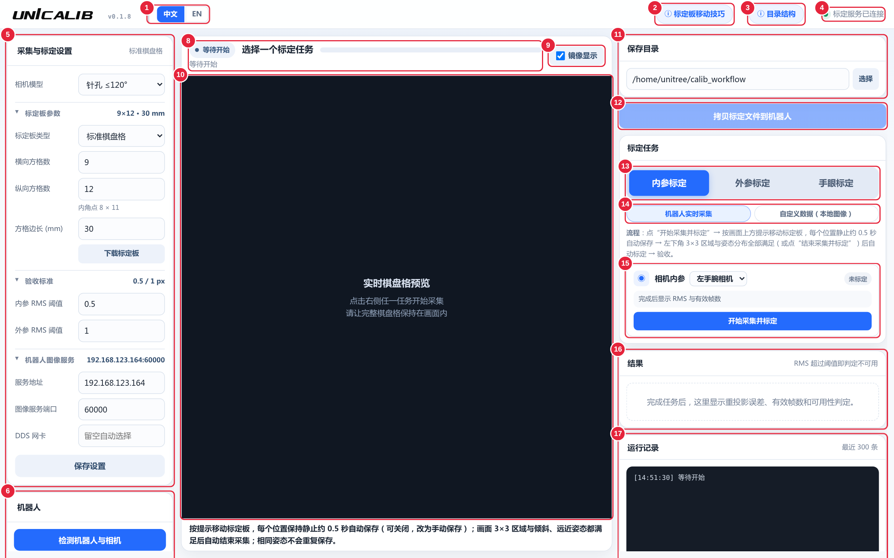
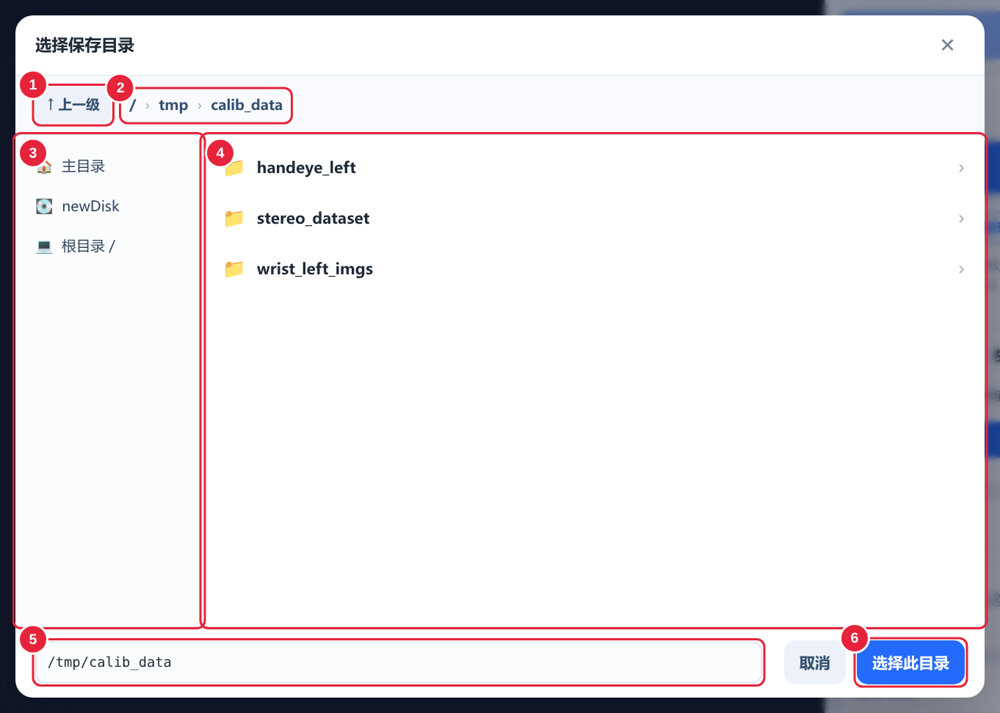

[← 返回 README](../README_zh-CN.md)

## 5、 🖥️ 界面总览

| 编号 | 区域 / 按钮 | 作用 |
|---|---|---|
| 1 | 中文 / EN | 切换界面语言 |
| 2 | ⓘ 标定板移动技巧 | 鼠标移上去查看：实时采集时标定板应该怎么移动、倾斜、远近 |
| 3 | ⓘ 目录结构 | 鼠标移上去查看：结果保存的目录结构，以及自定义数据（内参 / 外参 / 手眼）应该怎么准备 |
| 4 | 服务状态 | “标定服务已连接”（绿点）表示页面与本机 UNICALIB 程序连接正常；显示“服务连接失败”说明程序已退出，需重新启动 AppImage |
| 5 | 采集与标定设置 | 相机模型、标定板、验收标准、机器人图像服务，见第 6 节 |
| 6 | 机器人 | **检测机器人与相机**，并显示机器人编号与相机状态，见第 6 节 |
| 7 | 角点与姿态分布 | 实时采集时显示画面 3×3 区域的角点覆盖情况和标定板姿态（左右 / 上下倾斜、远近）是否采够 |
| 8 | 任务状态栏 | 当前阶段（等待开始 / 采集中 / 标定中 / 完成）、任务名称、进度条与提示信息 |
| 9 | 镜像显示 | 面对相机操作时勾选，画面和提示的左右与操作者一致；采集时这一栏还会出现更多按钮，见第 10 节 |
| 10 | 实时预览 | 显示相机画面、检测到的角点和大字移动提示；下方是操作说明 |
| 11 | 保存目录 | 所有标定结果的保存位置。可直接输入路径，或点 **选择** 打开目录选择窗口（见下图） |
| 12 | 拷贝标定文件到机器人 | 把本地标定结果写入机器人，见第 12 节。需先读取机器人编号，否则为灰色不可点 |
| 13 | 标定类型 | 内参标定 / 外参标定 / 手眼标定 |
| 14 | 数据来源 | **机器人实时采集**（连接机器人现场采集）/ **自定义数据（本地图像）**（使用已有图像） |
| 15 | 任务卡片 | 选择具体相机或手臂、查看状态（未标定 / 可用 / 不可用）、点按钮开始。13 和 14 的组合不同，卡片内容不同，见第 7–9 节 |
| 16 | 结果 | 任务完成后显示重投影误差（RMS / P95）、有效帧数和是否可用；手眼标定在这里有 **3D 查看** |
| 17 | 运行记录 | 本次运行的操作与提示日志（最近 300 条） |

### 目录 / 文件选择窗口

点击页面上任意 **选择** 按钮会打开这个窗口（浏览的是运行 UNICALIB 的这台电脑上的文件）：

| 编号 | 作用 |
|---|---|
| 1 | 返回上一级目录 |
| 2 | 当前路径，点任意一级可直接跳转 |
| 3 | 常用位置：上次选择的目录、主目录、已挂载的磁盘、根目录 |
| 4 | 当前目录下的文件夹（选文件时也会列出可选的文件）；含图像的文件夹标出图像数量，符合外参数据格式的标出“外参数据根目录”。单击文件夹进入；选文件时单击文件即完成选择 |
| 5 | 直接输入路径，回车跳转 |
| 6 | 选择当前所在的目录 |
