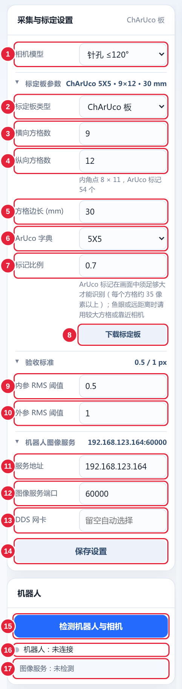

[← 返回 README](../README_zh-CN.md)

## 6、 🛠️ 开始前的设置（左侧）

点击“标定板参数”“验收标准”“机器人图像服务”标题可展开 / 收起。截图为选择“ChArUco 板”时的界面；选择标准棋盘格时不显示 6、7 两项。

| 编号 | 设置 / 按钮 | 说明 |
|---|---|---|
| 1 | 相机模型 | 针孔 ≤120° / 鱼眼KB >120°，按镜头视场角选择。内参、外参都按此模型标定 |
| 2 | 标定板类型 | **标准棋盘格**（默认）或 **ChArUco 板**，区别见 4.2 节 |
| 3 | 横向方格数 | 按**方格**数填写，不是角点数。下方会提示对应的内角点数（方格数 − 1），ChArUco 板还会提示标记个数 |
| 4 | 纵向方格数 | 同上。标准棋盘格做外参标定时要求横纵方格数不同（如 9×12） |
| 5 | 方格边长 (mm) | 用尺子量实际打印出来的方格边长。决定外参 / 手眼平移的尺度，**务必填准** |
| 6 | ArUco 字典 | 仅 ChArUco 板：4X4 / 5X5 / 6X6 / 7X7，须与打印的板一致 |
| 7 | 标记比例 | 仅 ChArUco 板：ArUco 标记边长 / 方格边长（默认 0.7），须与打印的板一致 |
| 8 | 下载标定板 | 按上面的参数生成 1:1 真实尺寸的标定板 PDF（标准棋盘格或 ChArUco）；打印时选择“实际大小 / 100%”，不要缩放 |
| 9 | 内参 RMS 阈值 | 内参重投影误差超过该值判定为不可用（像素） |
| 10 | 外参 RMS 阈值 | 外参重投影误差超过该值判定为不可用（像素） |
| 11 | 服务地址 | 机器人 IP，即 TeleImager 图像服务所在地址（默认 `192.168.123.164`） |
| 12 | 图像服务端口 | TeleImager 图像服务的配置端口（默认 `60000`） |
| 13 | DDS 网卡 | 手眼标定时**本机**收发 DDS 关节数据用的网卡名（如 `eth0`、`enp3s0`），一般留空，自动选择本机连接机器人的那块网卡 |
| 14 | 保存设置 | 保存左侧所有设置，下次启动自动沿用 |
| 15 | 检测机器人与相机 | 连接机器人：首次会弹窗输入 SSH 账号密码，然后读取机器人编号、检测图像服务中的相机及实际分辨率 / 帧率 |
| 16 | 机器人状态 | 显示是否已连接及机器人编号 |
| 17 | 图像服务状态 | 显示图像服务是否可用；检测成功后可展开“详细信息”查看每路相机 |
