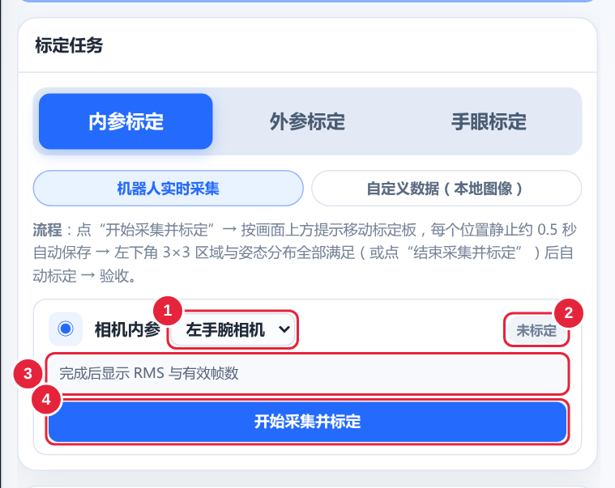
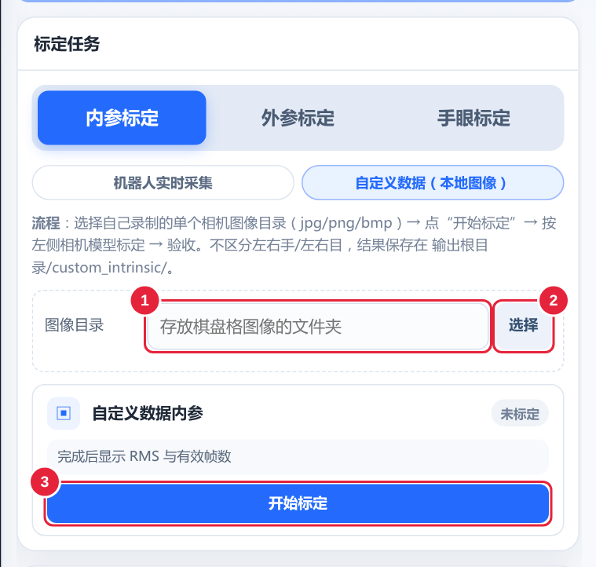

[← 返回 README](../README_zh-CN.md)

## 7、 📷 内参标定

### 7.1 机器人实时采集

标定类型选 **内参标定**，数据来源选 **机器人实时采集**：

| 编号 | 作用 |
|---|---|
| 1 | 选择要标定的相机：左手腕相机 / 右手腕相机 / 左目相机 / 右目相机 |
| 2 | 该相机的状态：未标定 / 采集中 / 可用 / 不可用 |
| 3 | 上次标定的结果（RMS、P95、帧数），采集中显示已采集帧数 |
| 4 | **开始采集并标定**：连接图像服务开始采集，按画面提示移动标定板（拍法见第 4 节），采够后自动标定并验收 |

### 7.2 自定义数据

标定类型选 **内参标定**，数据来源选 **自定义数据（本地图像）**：

| 编号 | 作用 |
|---|---|
| 1 | 图像目录：存放同一台相机拍摄的标定板图像的文件夹（建议 20–40 张，拍法按第 4 节） |
| 2 | 选择：打开目录选择窗口 |
| 3 | **开始标定**：按左侧的相机模型和标定板参数标定，完成后在“结果”中显示验收结论 |

> 自定义数据（内参 / 外参 / 手眼）支持的图像格式：`.jpg`、`.jpeg`、`.png`、`.bmp`（扩展名不区分大小写）。
> 只读取所选目录下直接存放的图像，不读取子目录。
