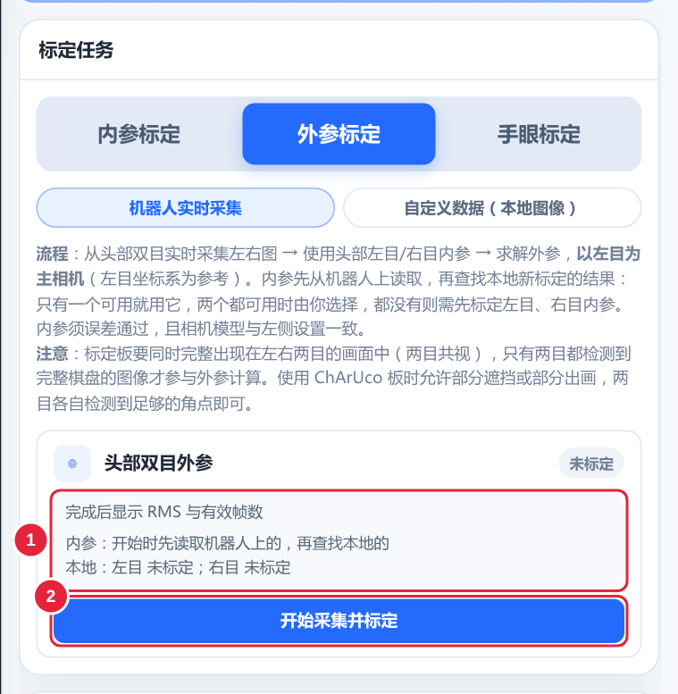
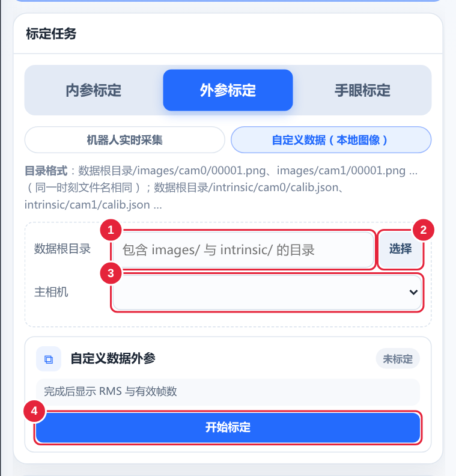

[← 返回 README](../README_zh-CN.md)

## 8、 🔭 外参标定

### 8.1 头部双目（机器人实时采集）

标定类型选 **外参标定**，数据来源选 **机器人实时采集**：



| 编号 | 作用 |
|---|---|
| 1 | 上次结果，以及本地左目 / 右目内参的状态 |
| 2 | **开始采集并标定** |

* 以**左目为主相机**，需要先有可用的左目、右目内参
* 程序会同时查找机器人上已有的内参和本地最新的内参：
  只有一个可用就直接使用；两个都可用会弹窗让你选择；都没有则提示先标定左目、右目内参
* 点开始后，按提示移动标定板，使其同时出现在左右两个画面中；只有两目都检测到棋盘（标准棋盘格须完整，ChArUco 板须足够多角点）的图像才参与计算

### 8.2 自定义数据

标定类型选 **外参标定**，数据来源选 **自定义数据（本地图像）**：



| 编号 | 作用 |
|---|---|
| 1 | 数据根目录（格式见下） |
| 2 | 选择：打开目录选择窗口；选好后自动识别其中的相机 |
| 3 | 主相机：外参结果为其他相机 → 主相机的变换 |
| 4 | **开始标定** |

数据根目录格式如下（同一时刻的图像文件名相同）：

```
数据根目录/
├─ images/cam0/00001.png, images/cam1/00001.png, …
└─ intrinsic/cam0/calib.json, intrinsic/cam1/calib.json, …   （可选）
```

* 自动识别 `images/` 下的 `cam*` 子目录（至少 2 个），可选择主相机（默认编号最小的相机）
* 内参：每个相机读取 `intrinsic/cam*/calib.json`（没有 `calib.json` 时，目录中只有一个 `.json` 也可）
* **缺少内参的相机会先用它自己的图像自动标定内参**（使用页面上当前选择的相机模型），再标定外参；
  `intrinsic/` 目录整个省略也可以，此时所有相机都自动标定内参

> 标定板上**不需要**红色标记。
