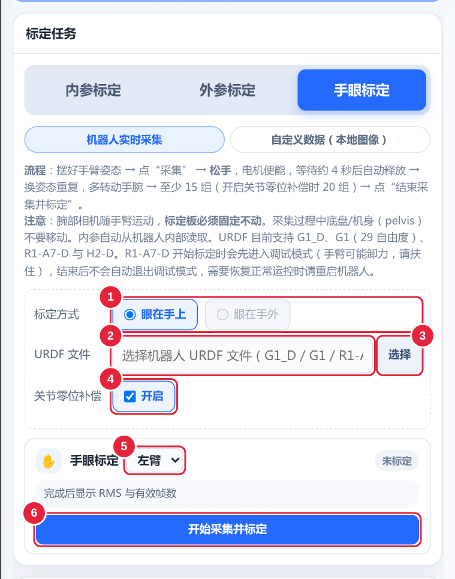
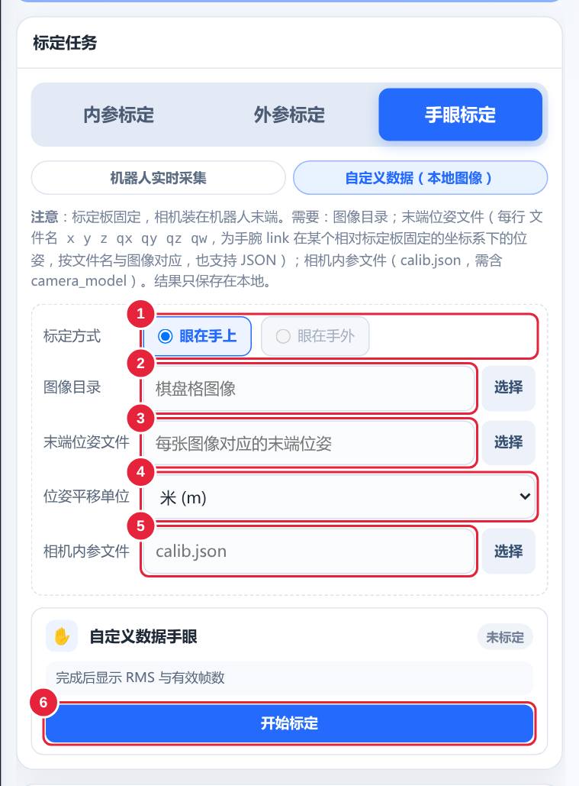

[← 返回 README](../README_zh-CN.md)

## 9、 🦾 手眼标定（眼在手上）

目前只支持**眼在手上**（相机装在手腕上，标定板固定）。

### 9.1 准备

* **标定板固定不动**，底盘不要移动
* 准备好机器人的 URDF 文件：本仓库 [`urdf/`](../urdf/) 下提供 G1（29 自由度）、G1_D 与 R1-A7-D（不打包进 AppImage），机型对应关系见第 1 节表格。G1 锁腰版本暂不支持
* 先完成对应腕部相机的**内参标定并拷贝到机器人**（手眼标定会从机器人 `/home/unitree/calib/uniclib_calibration.json` 读取腕部内参）
* **建议用网线连接机器人**：关节数据与使能保持指令在本机经 DDS 收发，0.3 秒收不到关节数据时保持会自动释放
* **G1**：标定时机身必须固定（吊起或靠稳），使能保持期间腿部不受控制
* **R1-A7-D**：
  * 开始标定时程序会先让机器人**进入调试模式**（手臂可能卸力，请先扶好或放在安全位置）；结束后**不会自动退出调试模式**，需要恢复正常运控时请重启机器人
  * 升降必须已回零，否则会提示不能标定

### 9.2 机器人实时采集

标定类型选 **手眼标定**，数据来源选 **机器人实时采集**：

| 编号 | 作用 |
|---|---|
| 1 | 标定方式：眼在手上（相机装在手腕上，标定板固定）；“眼在手外”暂不支持 |
| 2 | URDF 文件：机器人的 URDF 路径（G1_D / G1 29 自由度 / R1-A7-D） |
| 3 | 选择：打开文件选择窗口，选择 `.urdf` 文件 |
| 4 | 关节零位补偿：同时估计关节零位偏差（默认开启，需至少 20 组） |
| 5 | 选择手臂：左臂 / 右臂 |
| 6 | **开始采集并标定**：开始后进入逐组采集，用页面上方的 **采集** 按钮采每一组（见第 10 节） |

步骤：

1. 选好 URDF 和手臂，点 **开始采集并标定**；页面先显示按 URDF 识别出的机器人型号与运动链，确认后才开始采集
2. 手动把手臂摆到一个姿态，使标定板完整出现在腕部相机画面中
3. 点页面上方的 **采集** 按钮，然后**松手**：程序让这只手臂原地使能保持，稳定后采集约 1 秒，再自动释放（共约 4 秒）
   **采集期间请勿触碰机械臂。**
4. 重复第 2–3 步，每组之间转动几十度、绕不同方向转（总旋转跨度 ≥ 30°）
5. 至少 15 组才能结束并标定（开启关节零位补偿时 20 组），建议 15–20 组；姿态怎么选见 4.6 节
6. 采集不合格（抖动 / 漂移过大、标定板检测不到）时不会保存，并显示原因；可点 **撤销上一组**

> 使能保持的安全措施：使能前检查没有其他程序在控制手臂；增益渐升；关节偏离过大或速度过快、关节数据中断、本程序退出、点击停止时都会立即释放。

### 9.3 自定义数据

标定类型选 **手眼标定**，数据来源选 **自定义数据（本地图像）**：

| 编号 | 作用 |
|---|---|
| 1 | 标定方式：眼在手上 |
| 2 | 图像目录：腕部相机拍摄的标定板图像（标定板固定不动） |
| 3 | 末端位姿文件：每张图像对应的手腕位姿（格式见下） |
| 4 | 位姿平移单位：米 (m) / 毫米 (mm) |
| 5 | 相机内参文件：`calib.json`，需含 `camera_model` |
| 6 | **开始标定**；结果只保存在本地 |

2、3、5 右侧的 **选择** 按钮用于打开选择窗口。

位姿文件按文件名与图像对应，二选一：
* 文本：每行 `文件名 x y z qx qy qz qw`（逗号或空格分隔，`#` 为注释，平移单位 m 或 mm）
* JSON：`{"000001": 4×4 矩阵 | [x,y,z,qx,qy,qz,qw] | {"position", "quaternion"}}`

### 9.4 查看结果

验收结果中的 **3D 查看** 可显示机器人、标定得到的相机位置和视场、标定板，并可逐组切换采集姿态，与真实机器人对照。

> 若开启了关节零位估计并使用补偿后的结果，正运动学须使用 **实际关节角 = 读数 + 零位**。

### 9.5 其他机器人

“机器人实时采集”需要知道每个关节的数据从哪里读（lowstate 电机编号、升降 / 腰部的话题）以及如何使能保持手臂，
这些按机型写在程序里，目前只有 **G1_D、G1（29 自由度）与 R1-A7-D**。

* **怎么识别**：先按 URDF 的 `<robot name>` 认机型，再逐个核对 `<base_link> → <左/右>_wrist_yaw_link` 上可动关节的个数、类型与转轴；
  名称认不出时只按关节逐个机型匹配
* **其他机器人**（包括 G1 锁腰版本、G1 23 自由度，以及其他型号）：开始前就会提示“所选 URDF … 与支持的机器人型号都不一致”
  或“关节核对未通过”，**不能开始采集**，也不会连接或驱动机器人
* **可以用“自定义数据”标定**（9.3 节），这种方式与机器人型号无关：
  1. 标定板固定，手臂摆到不同姿态（要求同 4.6 节），每个姿态用腕部相机拍一张图，同时记录手腕（末端）在机器人基座坐标系下的位姿
     （用该机器人自己的 SDK / 正运动学计算），按 9.3 节的格式写成位姿文件
  2. 准备好该腕部相机的内参文件 `calib.json`（可先用“内参标定”得到）
  3. 选择图像目录、位姿文件、平移单位和内参文件，点 **开始标定**；结果保存在本地 `handeye/custom/<时间>/handeye.json`，
     不会自动拷贝到机器人
* 需要为新机型支持“机器人实时采集”时，要在程序中增加该机型的配置（关节与 lowstate 编号对应、升降 / 腰部话题、使能保持增益等）
  并重新发布 AppImage，请联系开发者
