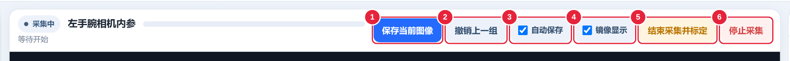

[← 返回 README](../README_zh-CN.md)

## 10、 ⏺️ 实时采集时的按钮

开始实时采集后，预览画面上方会出现以下按钮（不同任务只显示其中一部分）：

| 编号 | 按钮 | 作用 |
|---|---|---|
| 1 | 保存当前图像 | 内参 / 外参：手动保存当前这一帧（自动保存关闭时只能用它）。手眼标定时变为 **采集（约 1 秒）**，每点一次采一组 |
| 2 | 撤销上一组 | 仅手眼标定：删除最近保存的一组 |
| 3 | 自动保存 | 勾选：标定板静止约 0.5 秒自动保存；取消：只能手动点 1 保存 |
| 4 | 镜像显示 | 面对相机操作时勾选，画面左右与操作者一致 |
| 5 | 结束采集并标定 | 不再等待自动结束，用已采集的图像立即标定 |
| 6 | 停止采集 | 放弃本次采集，**不进行标定**（标定开始后不能停止） |

### 采集中的提示

* 画面上方大字提示下一步：蓝 = 移动到某处 / 调整倾斜，黄 = 保持静止，绿 = 已保存，红 = 有问题（看不到完整的板、太小、倾斜过大、反光）
* 每个位置**静止约 0.5 秒**自动保存；与已保存图像太相似的不会重复保存
* 左侧 **角点与姿态分布** 全部满足后自动结束并标定；也可随时点 **结束采集并标定**
* 标定板怎么拿、要拍哪些位置和角度，见**第 4 节**
