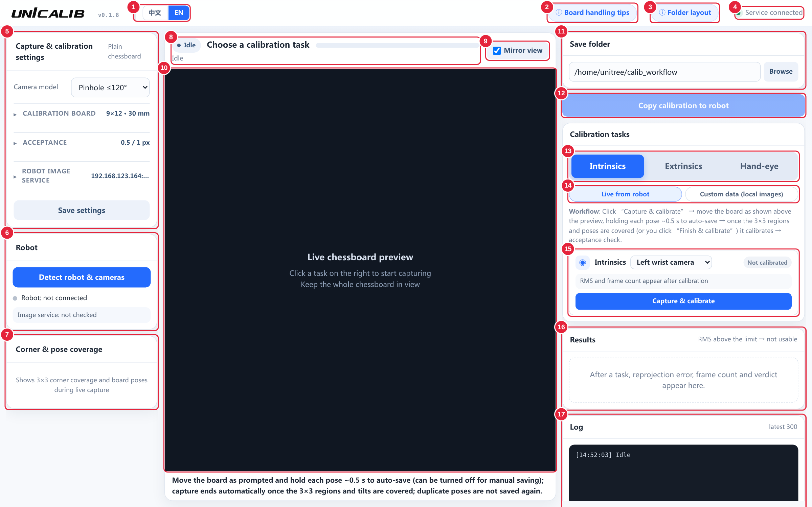
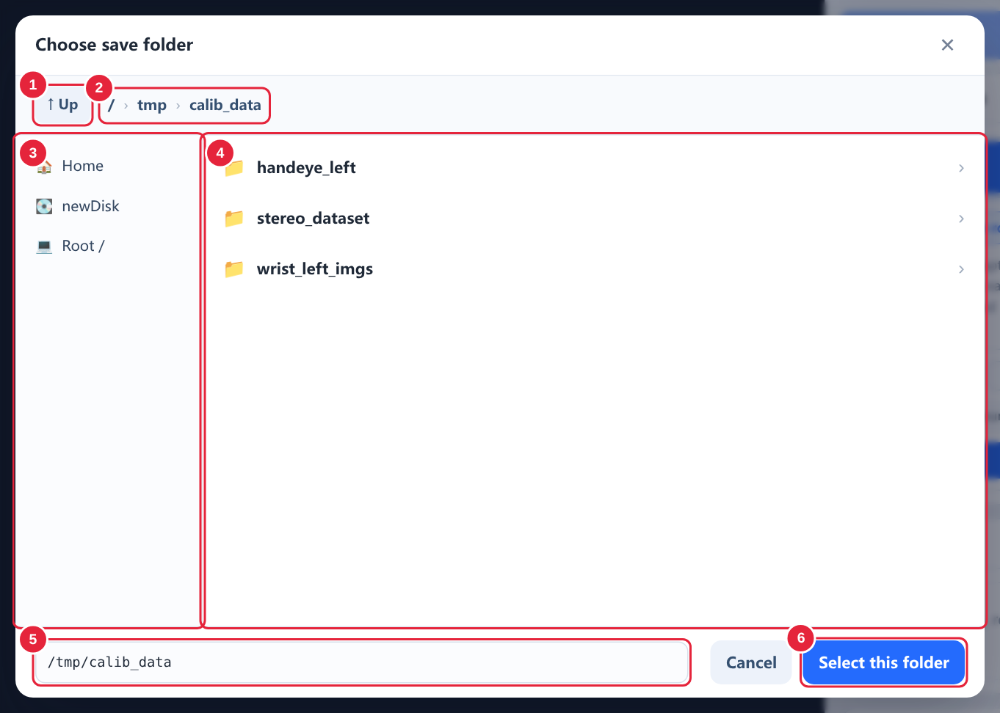

[← Back to README](../../README.md)

## 5、 🖥️ Interface Overview

| No. | Area / button | Purpose |
|---|---|---|
| 1 | 中文 / EN | Switch interface language |
| 2 | ⓘ Board handling tips | Hover to see how to move, tilt and distance the board during live capture |
| 3 | ⓘ Folder layout | Hover to see the result folder layout and how to prepare custom data (intrinsics / extrinsics / hand-eye) |
| 4 | Service status | "Service connected" (green dot) means the page is connected to the local UNICALIB program; "Service disconnected" means the program has exited — restart the AppImage |
| 5 | Capture & calibration settings | Camera model, board, acceptance, robot image service — see Section 6 |
| 6 | Robot | **Detect robot & cameras**; shows robot ID and camera status — see Section 6 |
| 7 | Corner & pose coverage | During live capture: corner coverage of the 3×3 image regions, and whether enough board poses (left/right, up/down tilt, near/far) have been captured |
| 8 | Task status bar | Current stage (waiting / capturing / calibrating / done), task name, progress bar and messages |
| 9 | Mirror view | Tick when facing the camera so left/right in the image and prompts match the operator; during capture more buttons appear here — see Section 10 |
| 10 | Live preview | Camera image, detected corners and large movement prompts; instructions below |
| 11 | Save folder | Where all calibration results are saved. Type a path or click **Browse** to open the folder picker (below) |
| 12 | Copy calibration to robot | Write local results to the robot — see Section 12. Greyed out until the robot ID has been read |
| 13 | Calibration type | Intrinsics / Extrinsics / Hand-eye |
| 14 | Data source | **Live from robot** (capture on site) / **Custom data (local images)** (use existing images) |
| 15 | Task card | Choose the camera or arm, see status (Not calibrated / Usable / Not usable), and start. Card content depends on 13 and 14 — see Sections 7–9 |
| 16 | Result | After a task: reprojection error (RMS / P95), valid frame count and usable or not; for hand-eye, the **3D view** is here |
| 17 | Log | Actions and messages of this session (last 300 entries) |

### Folder / file picker

Any **Browse** button opens this window (it browses files on the PC running UNICALIB):

| No. | Purpose |
|---|---|
| 1 | Up one level |
| 2 | Current path; click any segment to jump there |
| 3 | Shortcuts: last selected folder, home, mounted disks, root |
| 4 | Folders in the current directory (when picking a file, selectable files are listed too). Folders with images show the image count; folders matching the extrinsic data layout are marked "extrinsic data root". Click a folder to enter it; when picking a file, click the file to select it |
| 5 | Type a path and press Enter to jump |
| 6 | Select the current folder |
