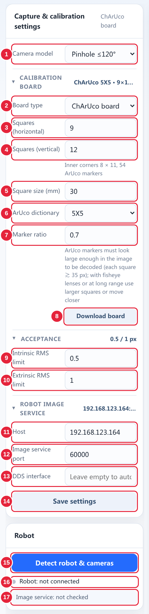

[← Back to README](../../README.md)

## 6、 🛠️ Settings Before You Start (left panel)

Click the "Calibration board", "Acceptance" or "Robot image service" headings to expand / collapse them. The screenshot shows the panel with "ChArUco board" selected; with a plain chessboard, items 6 and 7 are hidden.

| No. | Setting / button | Description |
|---|---|---|
| 1 | Camera model | Pinhole ≤ 120° / Fisheye KB > 120°, chosen by the lens field of view. Used for both intrinsics and extrinsics |
| 2 | Board type | **Plain chessboard** (default) or **ChArUco board**, see 4.2 |
| 3 | Squares (horizontal) | Number of **squares**, not corners. The inner-corner count (squares − 1) is shown below, plus the marker count for a ChArUco board |
| 4 | Squares (vertical) | Same as above. For extrinsics with a plain chessboard the two counts must differ (e.g. 9×12) |
| 5 | Square size (mm) | The measured size of the printed squares. Sets the scale of extrinsic / hand-eye translations, so **enter it accurately** |
| 6 | ArUco dictionary | ChArUco only: 4X4 / 5X5 / 6X6 / 7X7; must match the printed board |
| 7 | Marker ratio | ChArUco only: ArUco marker side / square side (default 0.7); must match the printed board |
| 8 | Download board | Generates a true-scale (1:1) PDF of the board (plain chessboard or ChArUco) from the settings above; print at "Actual size / 100%", no scaling |
| 9 | Intrinsic RMS limit | Intrinsic reprojection error above this (px) is rejected |
| 10 | Extrinsic RMS limit | Extrinsic reprojection error above this (px) is rejected |
| 11 | Host | Robot IP, i.e. where the TeleImager image service runs (default `192.168.123.164`) |
| 12 | Image service port | TeleImager config port (default `60000`) |
| 13 | DDS interface | Network interface **on this PC** for DDS joint data during hand-eye calibration (e.g. `eth0`, `enp3s0`). Usually leave empty: the interface connected to the robot is chosen automatically |
| 14 | Save settings | Saves all settings on the left; they are reused on the next start |
| 15 | Detect robot & cameras | Connects to the robot: asks for SSH username/password the first time, then reads the robot ID and detects the image service's cameras with their actual resolution / frame rate |
| 16 | Robot status | Connected or not, and the robot ID |
| 17 | Image service status | Whether the image service is available; after a successful check, expand "Details" to see each camera |
