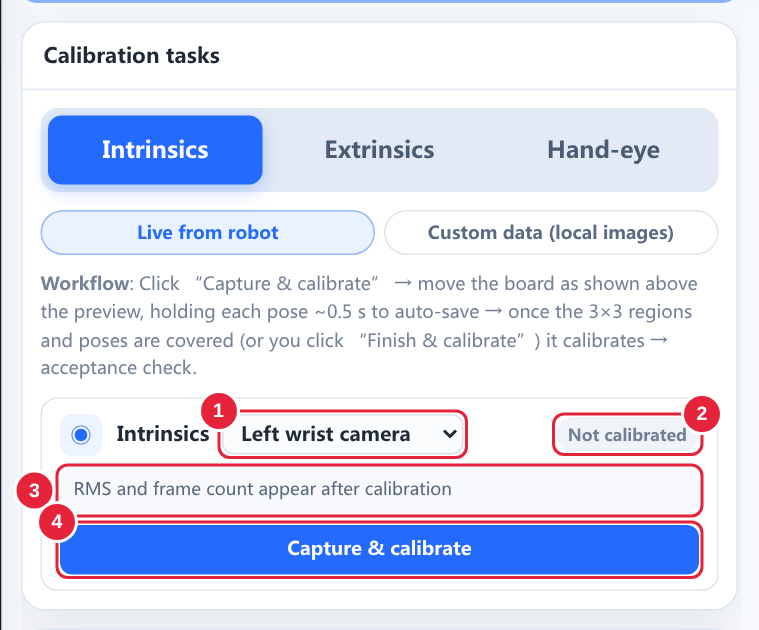
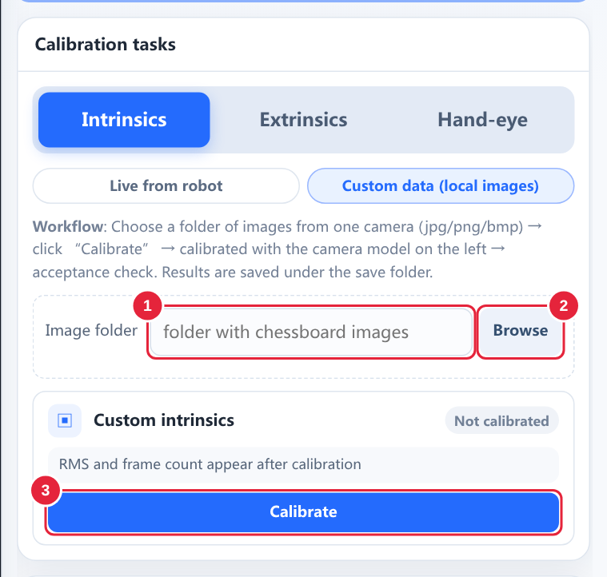

[← Back to README](../../README.md)

## 7、 📷 Intrinsic Calibration

### 7.1 Live from robot

Calibration type **Intrinsics**, data source **Live from robot**:

| No. | Purpose |
|---|---|
| 1 | Camera to calibrate: Left wrist camera / Right wrist camera / Head left camera / Head right camera |
| 2 | Its status: Not calibrated / Capturing / Usable / Not usable |
| 3 | Last result (RMS, P95, frames); during capture, the number of frames captured |
| 4 | **Capture & calibrate**: connects to the image service and starts capturing. Move the board as prompted (see Section 4); once enough is captured it calibrates and checks the result automatically |

### 7.2 Custom data

Calibration type **Intrinsics**, data source **Custom data (local images)**:

| No. | Purpose |
|---|---|
| 1 | Image folder: board images taken by one camera (20–40 recommended, captured as in Section 4) |
| 2 | Browse: opens the folder picker |
| 3 | **Calibrate**: uses the camera model and board settings on the left; the verdict appears under "Result" |

> Supported image formats for custom data (intrinsics / extrinsics / hand-eye): `.jpg`, `.jpeg`, `.png`, `.bmp` (extension case-insensitive).
> Only images directly in the selected folder are read, not subfolders.
