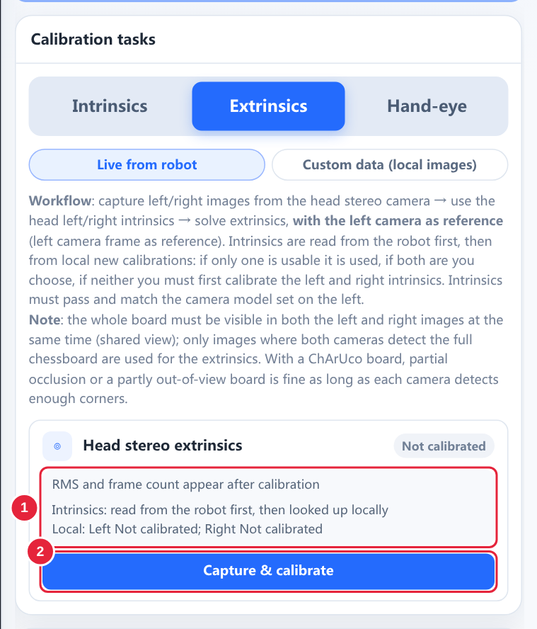
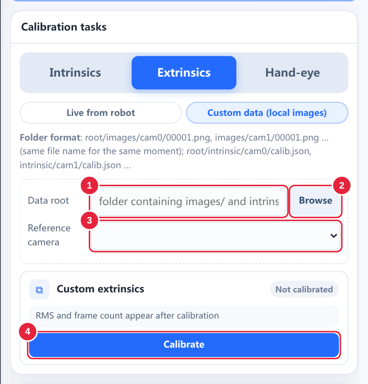

[← Back to README](../../README.md)

## 8、 🔭 Extrinsic Calibration

### 8.1 Head stereo (live from robot)

Calibration type **Extrinsics**, data source **Live from robot**:



| No. | Purpose |
|---|---|
| 1 | Last result, and the status of local left / right intrinsics |
| 2 | **Capture & calibrate** |

* The **left camera is the reference**; usable left and right intrinsics are required first
* The program looks for intrinsics both on the robot and locally (latest):
  if only one is usable it is used; if both are, a dialog lets you choose; if neither, you are asked to calibrate the left and right intrinsics first
* After starting, move the board as prompted so it appears in both views; only images where both views detect the board (complete for a plain chessboard, enough corners for ChArUco) are used

### 8.2 Custom data

Calibration type **Extrinsics**, data source **Custom data (local images)**:



| No. | Purpose |
|---|---|
| 1 | Data root (layout below) |
| 2 | Browse: opens the folder picker; cameras are detected automatically after selection |
| 3 | Reference camera: extrinsics are given as other camera → reference camera transforms |
| 4 | **Calibrate** |

Data root layout (images taken at the same moment share the same file name):

```
data_root/
├─ images/cam0/00001.png, images/cam1/00001.png, …
└─ intrinsic/cam0/calib.json, intrinsic/cam1/calib.json, …   (optional)
```

* `cam*` subfolders under `images/` are detected automatically (at least 2); the reference camera is selectable (default: lowest number)
* Intrinsics: each camera reads `intrinsic/cam*/calib.json` (if there is no `calib.json`, a single `.json` in the folder also works)
* **Cameras without intrinsics are first calibrated from their own images** (using the camera model currently selected on the page), then extrinsics are calibrated;
  the whole `intrinsic/` folder may be omitted, in which case all cameras are calibrated automatically

> The board does **not** need a red marker.
