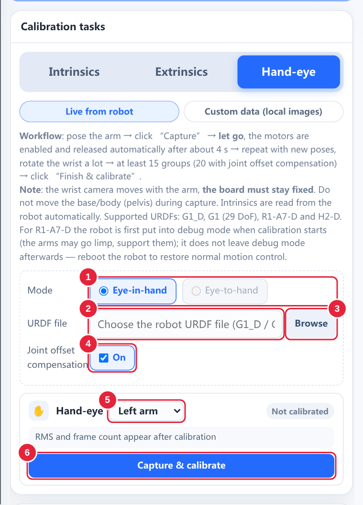
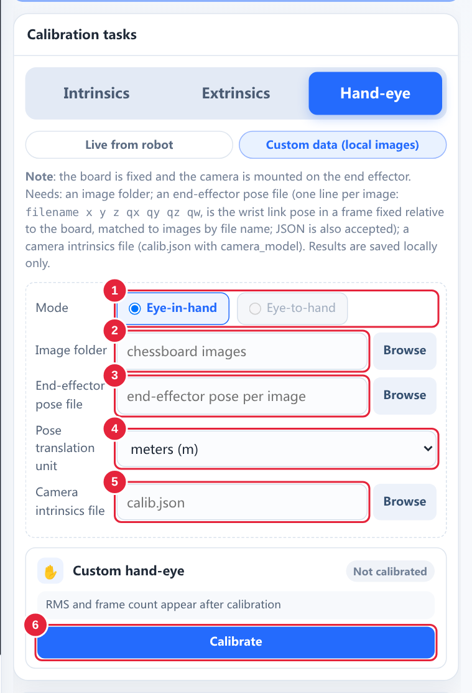

[← Back to README](../../README.md)

## 9、 🦾 Hand-eye Calibration (eye-in-hand)

Only **eye-in-hand** is supported (camera on the wrist, board fixed).

### 9.1 Preparation

* **The board is fixed**; do not move the base
* Have the robot's URDF ready: this repo's [`urdf/`](../../urdf/) folder provides G1 (29 DoF), G1_D and R1-A7-D (not bundled in the AppImage); see the table in Section 1. Waist-locked G1 versions are not supported yet
* First **calibrate the wrist camera's intrinsics and copy them to the robot** (hand-eye calibration reads the wrist intrinsics from `/home/unitree/calib/uniclib_calibration.json` on the robot)
* **Use a wired connection to the robot**: joint data and hold commands go over DDS from this PC; if no joint data arrives for 0.3 s the hold is released automatically
* **G1**: the torso must be fixed (hung or propped) during calibration; the legs are not controlled while the arm is held
* **R1-A7-D**:
  * At the start the program **switches the robot into debug mode** (the arms may go limp — support them or put them in a safe position first). It does **not switch back automatically**; reboot the robot to restore normal motion control
  * The lift must be homed, otherwise calibration is refused

### 9.2 Live from robot

Calibration type **Hand-eye**, data source **Live from robot**:

| No. | Purpose |
|---|---|
| 1 | Mode: Eye-in-hand (camera on the wrist, board fixed); "Eye-to-hand" is not supported yet |
| 2 | URDF file: path to the robot's URDF (G1_D / G1 29 DoF / R1-A7-D) |
| 3 | Browse: opens the file picker to choose a `.urdf` file |
| 4 | Joint offset compensation: also estimates joint zero offsets (on by default, needs at least 20 groups) |
| 5 | Arm: left / right |
| 6 | **Capture & calibrate**: starts group-by-group capture; use the **Capture** button above the preview for each group (Section 10) |

Steps:

1. Choose the URDF and arm, click **Capture & calibrate**. The page first shows the robot model and kinematic chain recognized from the URDF; capture starts after you confirm
2. Move the arm by hand to a pose where the whole board is visible in the wrist camera
3. Click **Capture** above the preview, then **let go**: the program holds this arm in place, waits for it to settle, captures for about 1 s, then releases it (about 4 s in total).
   **Do not touch the arm during capture.**
4. Repeat steps 2–3, rotating tens of degrees between groups about different axes (total rotation span ≥ 30°)
5. At least 15 groups are needed to finish (20 with joint offset compensation); 15–20 recommended. See 4.6 for how to choose poses
6. Groups that fail (too much jitter / drift, board not detected) are not saved and the reason is shown; **Undo last group** removes the latest group

> Hold safety: before enabling, the program checks that nothing else is controlling the arm; gains ramp up gradually; the hold is released immediately on large joint deviation or speed, interrupted joint data, program exit, or when you click Stop.

### 9.3 Custom data

Calibration type **Hand-eye**, data source **Custom data (local images)**:

| No. | Purpose |
|---|---|
| 1 | Mode: Eye-in-hand |
| 2 | Image folder: board images from the wrist camera (board fixed) |
| 3 | End-effector pose file: wrist pose for each image (format below) |
| 4 | Pose translation unit: metres (m) / millimetres (mm) |
| 5 | Camera intrinsics file: `calib.json`, must contain `camera_model` |
| 6 | **Calibrate**; results are saved locally only |

The **Browse** buttons next to 2, 3 and 5 open the picker.

Poses are matched to images by file name, in either format:
* Text: one line per image, `filename x y z qx qy qz qw` (comma or space separated, `#` for comments, translation in m or mm)
* JSON: `{"000001": 4×4 matrix | [x,y,z,qx,qy,qz,qw] | {"position", "quaternion"}}`

### 9.4 Viewing the result

**3D view** in the result panel shows the robot, the calibrated camera position and field of view, and the board; you can step through the captured poses group by group and compare with the real robot.

> If joint offset estimation is on and you use the compensated result, forward kinematics must use **actual joint angle = reading + offset**.

### 9.5 Other robots

Live capture needs to know where each joint is read from (lowstate motor index, lift / waist topics) and how to hold the arm.
This is built into the program per robot model; currently only **G1_D, G1 (29 DoF) and R1-A7-D** are supported.

* **How the model is recognized**: first by the URDF's `<robot name>`, then by checking the number, type and axis of the movable joints on `<base_link> → <left/right>_wrist_yaw_link`;
  if the name is not recognized, the joints are matched against each model
* **Other robots** (including waist-locked G1, the 23-DoF G1 and other models): before capture starts you get "The selected URDF … matches no supported robot model"
  or "… but the joint check failed". **Capture cannot start**, and the robot is never connected to or driven
* **Use "Custom data" instead** (9.3), which works with any robot:
  1. Fix the board and move the arm through different poses (as in 4.6). For each pose take one image with the wrist camera and record the wrist (end-effector) pose in the robot base frame
     (computed with that robot's own SDK / forward kinematics); write the poses in the format of 9.3
  2. Prepare the wrist camera's intrinsics file `calib.json` (e.g. from "Intrinsics" calibration first)
  3. Choose the image folder, pose file, translation unit and intrinsics file, then click **Calibrate**. The result is saved locally in `handeye/custom/<time>/handeye.json`
     and is not copied to the robot automatically
* Live support for a new robot model requires adding that model's configuration to the program (joint ↔ lowstate index mapping, lift / waist topics, hold gains, …)
  and releasing a new AppImage; please contact the developers
