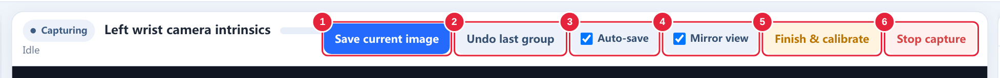

[← Back to README](../../README.md)

## 10、 ⏺️ Buttons During Live Capture

Once live capture starts, these buttons appear above the preview (each task shows only some of them):

| No. | Button | Purpose |
|---|---|---|
| 1 | Save current image | Intrinsics / extrinsics: save the current frame manually (the only way when auto-save is off). For hand-eye it becomes **Capture (~1 s)**: one group per click |
| 2 | Undo last group | Hand-eye only: delete the most recently saved group |
| 3 | Auto-save | On: saves when the board has been still for about 0.5 s; off: save only with button 1 |
| 4 | Mirror view | Tick when facing the camera so left/right match the operator |
| 5 | Finish & calibrate | Do not wait for auto-finish; calibrate now with the images captured so far |
| 6 | Stop capture | Abandon this capture **without calibrating** (cannot stop once calibration has started) |

### Prompts during capture

* The large prompt shows the next step: blue = move somewhere / adjust tilt, yellow = hold still, green = saved, red = problem (board not fully visible, too small, too tilted, glare)
* Each position is saved automatically after **holding still for about 0.5 s**; images too similar to saved ones are skipped
* When everything under **Corner & pose coverage** is satisfied, capture ends and calibration starts automatically; you can also click **Finish & calibrate** at any time
* For how to hold the board and which positions and angles to capture, see **Section 4**
